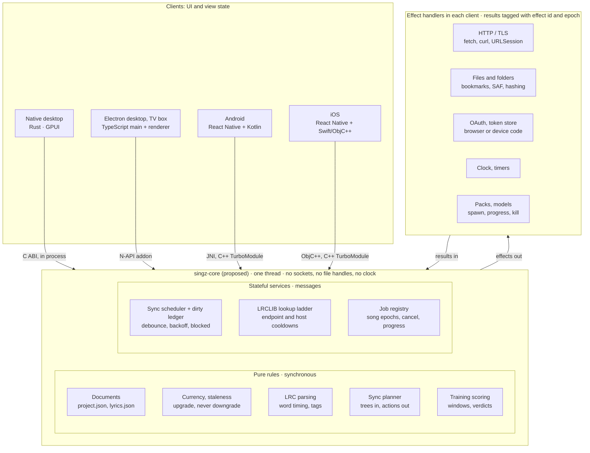

# RFC 0001: One shared core for SingZ's product rules

Status: draft, open for comment
Date: 2026-11-10
Branch measured: `codex/gpui-interface`; checked against the SingZ Box PR
(#145, `codex/box-app` at `7548e043`; merged into `main` as `c9465e4d` with head `d3d2f2f6`)
Related: [NATIVE-CORE-DESIGN.md](../NATIVE-CORE-DESIGN.md) (language profile,
ABI and dependency policy this RFC must follow),
[NATIVE-PLAYBACK-BRIDGE.md](../NATIVE-PLAYBACK-BRIDGE.md) (the manifest model
reused here), [experiments/gpui-player/NATIVE_INTEGRATION.md](../../experiments/gpui-player/NATIVE_INTEGRATION.md),
and on the Box branch `docs/specs/singz-box/loopz-integration.md` (the audio
host and LoopZ contract this RFC must sit beside)

## Scope

Domain state, project and lyrics documents, Drive sync, LRCLIB, training
scoring and job fencing, across the Electron desktop, the Rust/GPUI desktop,
the React Native phones and SingZ Box. Audio, detectors and UI are out of
scope: detectors already live in `zcore`, UI and view state stay in each
client, and audio has its own design. On Box that design is LoopZ, a separate
audio backend. A supervised headless audio host owns the devices, the routing
and native song rendering, and the UI talks to it over a private socket.
This RFC must not take any of that over. See
[The Box audio host](#the-box-audio-host-and-loopz).

Every line count below was measured with `wc -l` on this branch. Anything
inferred or estimated is marked *(inferred)* or *(estimate)*.

## Summary

| | |
|---|---|
| Rule sets today | 2: TypeScript (Electron, box, phones) and Rust (native desktop) |
| Drifts found in review | 6: five in the Rust port, one in the Box PR |
| Lines of Drive sync | 20,233 in the Rust port vs 1,788 in Electron |
| CI jobs that build or test the Rust crate | 0 |

**Recommendation.** Fund a shared core, written in C++ in this repository (not in the shared zCore), with the
TypeScript as the specification. Start with shared JSON case tables and a CI
job for the Rust crate, because both pay off whichever language is chosen. Make
the native desktop the first client of every module. Move the phones and
Electron onto a module only when the move deletes a copy. The language decision
stays open until the Phase 0 spike; see [Decision: C++ or Rust](#decision-c-or-rust).

**Why now.** The Rust port is still an experiment (`experiments/gpui-player`).
It already disagrees with Electron in five places, two of which can lose a
singer's work or re-read a whole library. Each week it ships more rules that
exist a second time. Extracting them before the native desktop replaces
Electron costs less than reconciling them afterwards.

**Cost.** About 18 to 24 engineer-weeks across six phases *(estimate)*. Each
phase stands alone and can be the last one funded. The core is estimated at
about 10k lines, sized from the TypeScript it replaces *(estimate)*.

**First step.** Phase 0, one to two weeks: extract case tables from the
existing vitest suites into `tests/shared/core/`, run them against the
TypeScript, add a `cargo build --locked` + `cargo test` job, and run the spike
that settles the language decision.

## The evidence: where copies already disagree

The first five come from the 2026-11-10 review of the Rust port. The sixth
comes from the Box PR. All six were re-checked against the code.

| Rule | Reference (TypeScript) | Rust port | Effect |
|---|---|---|---|
| LRCLIB host timeout | `src/shared/lrclib-transport.ts:36-40`: a timeout holds every endpoint for 60 s; manual retry has a 15 s floor | `lrclib.rs` has no host-level cooldown. `retry_now` (line 121) has no caller outside tests | During an outage every ladder step waits its own timeout. Retry returns "down" at once |
| `stemHashes` write-back | `src/main/gdrive.ts:911-918` writes refreshed hashes into the local `project.json` | `drive_snapshot.rs:369` sets them only on the uploaded copy | Every sync re-hashes every stem. On iCloud that re-downloads the library |
| Backward lyric words | Tolerated: `MIN_WORD_S` at `LyricsPanel.tsx:65` and `mobile/src/model.ts:376`; `sanitizeHyp` at `align.ts:49` | `project_lyrics.rs:87-103` bails on `e < s` | The whole file is refused, then auto-lookup can overwrite edited lyrics |
| Detector versions | Beat 23 and key 2 in `analysis-contract.ts:65-66`, pitch 4 in `melody.ts:28`; the same three in `zcore/include/zcore/legacy/{beats,analysis,melody}.h` | Beat read from the TS file by `include_str!` (`beat_analysis.rs:26`). Key is a literal 2 (`project_key.rs:14`), pitch a literal 4 (`project_pitch.rs:145`, `project_analysis.rs:256`). Stamp read with `as_u64` (`project_pitch.rs:60`) | A bump silently splits the clients. A float stamp reads as 0 and is downgraded |
| Clean-sync request count | About 4 requests: batched `in parents` queries, 50 folders each (`sync-plan.ts:35-39`) | O(projects × files), one curl process per request (`drive_http.rs:295`) | Over a thousand requests for 50 songs *(review estimate)* |
| Backward lyric words, a third reader (Box) | Same tolerance as above. The desktop's own read in `src/main/lyrics.ts` passes `raw.lines` through unchecked | Not Rust: on the Box branch, `src/shared/strict-lyrics.ts:47` returns `null` for the whole file when a word starts before the previous one, or a line has no words or ends at or before its start. Callers: `lyrics.ts:402` (`readCached`, behind `lyrics:get-cached`) and `box-audio/retained-recovery.ts:336` | `box/project.ts:56` then marks the song `needs-lyrics`, and retained-session recovery refuses it. Any song the old whisper path aligned can show on the TV as having no lyrics. **Fixed in `d3d2f2f6`, on `main` since #145 merged (`c9465e4d`):** the reader now clamps and repairs instead of refusing. It rejects only a non-object, an unknown `source`, or a file with no usable lines. Retained recovery uses the same parse, and auto-resolve no longer searches or transcribes over an unreadable file. The cases are in `tests/shared/lyrics-tolerance-cases.json` (12 entries, `{name, input, expected}`) |

The pattern in all six: the TypeScript rule changed, or carried a tolerance
that no test table states, and a new reader could not see it. The sixth shows
that a second copy is not only a cross-language problem: Box wrote a new
TypeScript reader in the same repository, and nothing stopped it from
disagreeing with the desktop's. Its fix also produced the first shared lyrics
table, `tests/shared/lyrics-tolerance-cases.json`, which the Rust reader in
`project_lyrics.rs` should run next.
`tests/shared/currency-cases.json` shows the fix that already works here: one
table, run by the TypeScript, Kotlin, Swift and desktop mtime implementations
alike.

## Current state

Who implements each rule area today. **own copy** = an independent
implementation; **shared TS** = a client that runs the Electron source.

| Rule area | Electron desktop (TS) | Native desktop (Rust) | Phones (RN + Kotlin/Swift) | C++ today |
|---|---|---|---|---|
| `project.json` model, save, migrate | `src/main/projects.ts` 1,206; `project-state.ts` 47; types in `src/shared/types.ts` 1,644 | **own copy**: `project_*.rs`, 17 files, 9,303 (`project_store.rs` 898), 141 tests | **own copy**: `mobile/src/projects.ts` 668, `project-document.ts` 87, `model.ts` 414 | None. Precedent: the graph document exists in C++ (`native/playback/native_playback_graph_document.cpp` 777) and TS (`src/shared/graph-document.ts` 707) against `graph-document-cases.json` |
| `lyrics.json` model, word guards | `src/main/lyrics.ts` 1,214; `align.ts` 661; render guard in `LyricsPanel.tsx` | **own copy**: `lyrics_*.rs` + `project_lyrics.rs`, 13 files, 7,818, 92 tests | **own copy** of the word guard in `model.ts:376` | None |
| Analysis staleness, detector versions | `src/renderer/src/audio/analysis-contract.ts` 105; `analysisIsStale` at line 78, 9 call sites in `App.tsx` and `Transport.tsx` | **own copy**: `project_analysis.rs` 364, `project_pitch.rs` 510, `project_key.rs` 378 | **shared TS** via the generated `mobile/src/gen/analysis-lib.js` | Version constants only: `kPitchDetectVersion`, `kBeatDetectVersion`, `kKeyDetectVersion` |
| Cache currency ("is this copy current?") | `isFresh` in `sync-plan.ts:162` | **own copy**: `is_fresh` in `drive_plan.rs:570` | **3 copies**: `mobile/src/current.ts` 71, `CacheCurrency.kt` 20, `CacheCurrency.swift` 25 | None. Table: `currency-cases.json` 269 |
| Drive sync planner and transport | `sync-plan.ts` 243 (pure); `gdrive.ts` 1,110; `drive-download.ts` 135 | **own copy**: `drive_*.rs`, 30 files, 18,435, of which 9 test files 5,176. Pure planner: `drive_plan.rs` 671. 217 tests | **own copy**, reader and publisher roles: `mobile/src/gdrive.ts` 1,122, `publish.ts` 699; publish tags retyped at `gdrive.ts:980-984` | None |
| Sync scheduler, dirty ledger | `sync-scheduler.ts` 308; `sync-dirty.ts` 127 | **own copy**: `sync_scheduler.rs` 522, `sync_dirty.rs` 696, 37 tests | No scheduler. Listings fenced by `listGen` (`gdrive.ts:389`) | None |
| LRCLIB parsing, ladder, cooldowns | `src/shared/lrclib-core.ts` 397; `lrclib-transport.ts` 181; `src/main/lrclib.ts` 66 | **own copy**: `lrclib.rs` 963, `lrclib_tests.rs` 582, 19 tests | **shared TS**: `mobile/src/lyrics/lrclib.ts` 76 wraps the two shared files | None |
| Training windows, session, scoring | `src/shared/training-*.ts`, 13 files, 3,036 (`training-session.ts` 1,627, `training-scoring.ts` 356) | **own copy**: `training*.rs`, 23 files, 10,849 including hosts (`training_scoring.rs` 365), 93 tests | **shared TS** bundled into `mobile/src/gen/training-lib.js` by `mobile/scripts/build-training.mjs`, plus 1,724 lines of phone glue in `mobile/src/training` | Audio side only (`training_pcm_mixer.h`, `training_phrase_renderer.cpp`) |
| Job fencing (song epochs, cancel) | `loadSeq` in `src/renderer/src/App.tsx` (83 mentions; file 4,392) | **own copy**: epoch and serial on every request (`integration.rs` 3,465); about 58 pending fields on `Player` *(from review)* | **own copy**: per-feature generations in JS | The audio helper's protocol (`tools/native/singz-gpui-audio.cpp` 1,575) |

**SingZ Box (PR #145).** Box is not a fork. It is a second product built from
the same Electron source tree, with its own app ID, profile directory, TV
renderer (`src/renderer/src/box/`) and packaging (`electron-builder.box.yml`).
The branch is level with `main`. Against `main` it changes the shared Drive
and project code very little: `gdrive.ts` by 8 lines, and `projects.ts` by 31
lines to give each product its own default library folder. It adds four
things that matter here:

- **`gdrive-device-auth.ts`**, the device-code OAuth step, because a TV has no
  browser for the loopback flow.
- **A headless audio host** (`--box-audio-host`, `src/main/box-audio/`). This
  is a separately supervised Electron process. It loads the N-API addon with
  LoopZ linked in and serves JSON lines over a private Unix socket
  (`wire.ts`). It outlives the TV UI.
- **A retained-session check** (`box-audio/retained-project.ts`, 158 lines).
  After a UI restart it re-reads `project.json`, the stems, `lyrics.json` and
  `graph.json`, and fingerprints them to decide whether the song the host
  still holds is the one on disk. That is a project-document rule, running in
  a process that is not the desktop.
- **A phone controller** with QR pairing, guest sessions, a queue and a mix
  scope (`src/main/box/phone-*.ts`). No other client has a queue today.

An earlier draft of this RFC compared Box against this branch and reported
158 differing lines in `gdrive.ts`. Most of that was this branch being 88
commits behind `main`, not Box diverging.

So for this RFC Box is the Electron client, with two additions: another
consumer of the project rules, which is the audio host, and a strict lyrics
reader of its own (the sixth drift).

**What the matrix shows.** The Rust column is the only one with an own copy in
every row. Phones and Electron already share source for three of the nine
areas. The phone duplication that remains is the currency rule (three copies
held by one table), document handling, and the Drive reader and publisher.

## Design principles

1. **One core holds the domain rules and decisions.** Project and lyrics
   document models; analysis staleness and currency; the sync planner,
   scheduler and dirty ledger; LRCLIB parsing and the lookup ladder; LRC word
   timing; training windows and scoring; a job registry for song epochs,
   cancellation and progress.
2. **Each client keeps the platform.** All UI and view state; HTTP and TLS; the
   OAuth browser (or device-code) step and secure token storage; file pickers,
   iOS security-scoped bookmarks and Android storage access; spawning packs and
   models.
3. **The core does no I/O.** It emits effects ("make this request", "read this
   file", "wake me at") and receives their results as values. Every rule is
   then testable from shared JSON case tables with no device, as
   `currency-cases.json` is today.
4. **Two call styles.** A message round trip is the wrong tool for a five-line
   pure rule: `analysisIsStale` has 9 call sites in the renderer, some in
   render paths, and the currency rule runs inside `FolderAccessModule.kt` and
   `FolderAccess.swift` download code with no JavaScript involved. Pure rules
   are synchronous functions with value arguments. Commands in and events out
   are only for the parts that hold state over time: the sync scheduler and
   ledger, the LRCLIB ladder with its cooldowns, and the job registry.
5. **Shared state means domain state, not view state.** The current project,
   load epoch, job status and sync status move into the core. Screens, dialogs,
   selection and focus never do. GPUI keeps owning the state it renders.
6. **The phones already share the TypeScript for three areas.** Training,
   LRCLIB and staleness reach the phones as the Electron source, bundled by
   esbuild. Moving those behind a native bridge on the phones removes no
   duplication and adds a bridge. So the native desktop is the first client in
   every phase, and a JavaScript client switches only where the switch deletes
   a copy. Until Electron and the box retire, the TypeScript for those areas
   stays as a port held to the same tables, the model the detectors already
   use: C++ is the truth, the TypeScript is a port, and the gates hold them
   together.

### Constraints from NATIVE-CORE-DESIGN.md

- **ABI.** The core crosses into JNI, ObjC++, N-API and Rust, so per
  § ABI boundaries it exposes a versioned `extern "C"` surface with fixed-width
  POD, explicit sizes and opaque handles, never STL containers, exceptions or
  C++ class layout. The Rust binding is therefore `bindgen` over that C header,
  not `cxx` over C++ types.
- **Execution profile.** The core is control-domain code and never runs on an
  audio callback. It may use exceptions internally (§ Language baseline) but
  catches them at the C boundary and returns status values.
- **Where it lives.** On `main`, zCore's base, media, device and DSP code is no
  longer in this repository. It lives in the external zCore repository, pinned
  as `third_party/zcore`. LoopZ consumes the same pin, and
  `scripts/verify-zcore-submodule.py` rejects dirty or overlaid checkouts.
  The in-tree `zcore/` keeps only the legacy detectors. The product core
  therefore lives in the SingZ repository, as its own CMake package beside
  in-tree `zcore/`. It never goes into zCore: zCore is shared with LoopZ, which
  has no songs, lyrics or Drive. The core has no dependency on `zcore_device`,
  `zcore_audio`, `zdsp` or LoopZ. It may read the detector version constants
  from the `zcore/legacy` headers.
- **JSON.** The Box build already links nlohmann::json, through LoopZ's
  `loopz_document_json` target, which is built position-independent so it can
  go into the Electron addon. A second library therefore needs a reason.
  nlohmann is fine for protocol messages. It does not meet the document
  requirement by default: it parses numbers to doubles and writes them back in
  shortest form, so `0.053999999999999999` becomes `0.054` and Drive sees a
  changed md5. So the choice is between two options, and Phase 0 tests both on
  the real library:
  - nlohmann for messages, plus a raw-number document path, either yyjson or
    nlohmann with numbers kept as text;
  - yyjson for both.

  Whichever library is chosen, if it is new to SingZ's own targets it needs a
  row in the § Libraries table.

## Target architecture

Everything inside `singz-core` is proposed; nothing in it exists yet.



| Module (proposed) | Holds | Style | Specification |
|---|---|---|---|
| `documents` | Parse, validate, migrate and re-serialize `project.json` and `lyrics.json`. Unknown fields and number text survive a round trip. A document that fails validation is reported as `invalid` and never treated as absent. | Pure | `src/main/projects.ts`, `lyrics.ts`, `mobile/src/project-document.ts` |
| `currency` | `isCurrent`, `isFresh` with the 2 ms mtime tolerance, `filesOfProject`, `analysisIsStale`, the three detector versions | Pure | `mobile/src/current.ts`, `sync-plan.ts:160-186`, `analysis-contract.ts` |
| `lrc` | LRC parsing, word timing at about 12 characters a second, tag and filename cleanup | Pure | `src/shared/lrclib-core.ts` |
| `lrclib` | The lookup ladder, endpoint cooldowns, the host-wide timeout, the manual-retry floor | Service | `lrclib-core.ts`, `lrclib-transport.ts` |
| `sync-plan` | Local tree plus Drive listing in, ordered actions out. Adoption, published-folder protection, the empty-library refusal, orphan trashing, catalog format 2 written last | Pure | `sync-plan.ts`; the decision parts of `gdrive.ts`, `mobile/src/gdrive.ts` and `publish.ts` |
| `sync-run` | Dirty ledger, single flight, 4 s debounce with 60 s max wait, backoff, `blocked` on auth, sweeps | Service | `sync-scheduler.ts`, `sync-dirty.ts` |
| `training` | Windows, scoring, verdicts | Pure | `src/shared/training-scoring.ts` first; `training-session.ts` later |
| `jobs` | Song epochs, request serials, cancellation, progress | Service | The Rust `integration.rs` discipline and Electron's `loadSeq` |

**Effects or callbacks.** Services emit effects as data, because a list of
effects can be written into a case table and replayed. A plain callback is used
only where the data is too large to pass as a value. Stem hashing is the one
case: the client streams the file and returns md5, size and mtime.

**Rules the core must carry, from CLAUDE.md.**

- The planner never reads the dirty ledger, or its own hash backfill would
  re-dirty every project.
- The ledger decides whether to sync, never what to upload.
- A cancel is never a verdict on the data.
- The phone's order of `engine.unload()` then `releaseProject()` stays in the
  phone. The core announces that a song closed and owns no audio buffer.

## Message protocol

All names below are proposed. JSON is notation for this document and for case
tables. Across a binding, a message is a typed value tree (null, bool, int64,
double, string, bytes, list, map) that each binding converts straight into its
platform's types.

```text
// 1. Open a project. The client picked epoch 42 when the singer chose the song.
command { "type":"project.open", "epoch":42, "serial":7, "dir":"Wild World" }
effect  { "type":"fs.read", "effect":311, "epoch":42, "path":"Wild World/project.json" }
result  { "effect":311, "ok":true, "bytes":"<utf-8>", "size":18230, "mtimeMs":1794300000123 }
event   { "type":"project.opened", "epoch":42, "serial":7,
          "stale":{ "beat":true, "pitch":false, "key":false }, "doc":{ … } }

// 2. Lyrics lookup. The song changed before LRCLIB answered.
command { "type":"lyrics.lookup", "epoch":42, "serial":8, "artist":"Cat Stevens",
          "title":"Wild World", "durationS":200 }
effect  { "type":"http.request", "effect":312, "epoch":42, "method":"GET",
          "url":"https://lrclib.net/api/get?…", "timeoutMs":10000 }
command { "type":"song.switch", "epoch":43 }
effect  { "type":"effect.cancel", "effect":312 }
result  { "effect":312, "ok":false, "class":"offline", "reason":"timeout" }  // epoch 42 is retired
event   { "type":"lrclib.host", "holdUntilMs":1794300060000 }   // host rule still learns from it
// no lyrics.resolved for serial 8: the core dropped it

// 3. A save marks the library dirty. The scheduler asks to be woken.
command { "type":"sync.markDirty", "dir":"Wild World", "reason":"save", "nowMs":1794300000500 }
effect  { "type":"timer.set", "effect":313, "atMs":1794300004500 }
event   { "type":"sync.status", "phase":"waiting", "dirtySeq":118 }
```

### Fencing stale results

This reuses the audio helper's discipline, which the review found sound: one
load epoch per song, one serial per request, both checked when a result
arrives. The core applies it in three places:

- Every command names the epoch it was issued under. A command for a retired
  epoch is refused with class `stale`.
- Every effect is stamped with the epoch that caused it. A result for a retired
  epoch never becomes a song event. Facts about the outside world, such as an
  LRCLIB host timeout, are still learned from it.
- Every event carries epoch and serial, so the client can apply the same check
  to its own view state.

This is the "capture at call time, answer from the owner's counter" rule from
the lyrics song-switch bug. The core owns the counter, so no client closure can
compare two stale values. Library-scoped work (sync) uses a run number in place
of a song epoch, the role `listGen` plays in `mobile/src/gdrive.ts`.

`epoch` and `serial` go in every message from Phase 1, although the job
registry lands last: adding them later would be a protocol break.

**Align with the Box audio host before freezing names.** The Box audio host
already ships this discipline, with tests, under other names. Its `epoch` is
the service lifetime, which changes when the host restarts. Its `generation`
is the prepared song. This RFC's "song epoch" is Box's generation. Two
meanings of `epoch` in one codebase will produce a bug.

**Recommendation:** adopt Box's vocabulary in Phase 0.

- `generation` is the song.
- `serial` is the request.
- `instance` is the core's lifetime, returned by `core.hello`. Box calls this
  the service epoch.

The host also has two rules this RFC should adopt as written:

- **A lost reply is uncertain, never a failure.** The client reads canonical
  state before acting and never replays a command blindly.
- **A new instance does not authorize replay.** Commands issued to a previous
  instance are not re-sent to a fresh one.

For the core, an uncertain reply mostly means an upload or a lyrics write
whose result was lost. The planner must re-list before it re-sends either.

### Error classes

Keep the five kinds in `SyncErrorKind` (`auth`, `offline`, `transient`,
`config`, `fatal`) and add five: `stale`, `cancelled`, `invalid` for a document
that fails validation, `unsupported` for an unknown command, and `uncertain`
for an effect whose result was lost, as Box's host already does. Today
`classifySyncError` (`sync-scheduler.ts:55-73`) derives the kind by searching
English error text for words like "timeout" and "socket". With effects, the
client reports a status code or a timeout as data and the core classifies it.
The `invalid` class exists so that "could not parse" can never authorize an
automatic overwrite.

### Numbers and iOS

No core number reaches iOS as JSON text: `NSJSONSerialization` misreads
17-digit doubles, and the existing iOS binding already builds its results from
the core's doubles for that reason (`mlGridRounded`, used in
`mobile/ios/SingzCore/SingzSplit.mm`). The iOS binding builds `NSNumber` and
JSI values from the value tree directly. Document bodies cross as opaque UTF-8
bytes and only the core parses them. Counters and times are int64 and stay
below 2^53 so JavaScript holds them exactly.

### Versioning

The first exchange is `core.hello`, which returns a protocol integer, the three
detector versions and a build fingerprint (the same source-hash provenance
`singz-analyze` carries). Adding an optional field or a new event keeps the
number. Removing a field or changing a meaning bumps it, and a binding refuses a
core it was not built for, the way `interfaceVersion` and
`playbackContractVersion` gate the playback bridge.

The surface is pinned in a hand-edited `tests/shared/core-bridge-manifest.json`
*(proposed)*: every command, event and effect with its field names and types,
and every enum table. A test per binding extracts the same facts from that
binding's source and compares, as
`tests/unit/native-playback-bridge-manifest.test.ts` does today. It is edited by
hand for the same reason the playback manifest is: regenerating it would let
drift fix itself.

## Per-client integration

| Client | Binding (proposed) | Threading | Notes from the code |
|---|---|---|---|
| Native desktop (Rust/GPUI) | In process, `bindgen` over the core's C header, with a thin safe Rust wrapper. With a Rust core this is a plain crate dependency instead. | The core runs on its own worker thread. Events reach the UI over the existing `mpsc` channel as `Event` values. GPUI keeps owning what it renders. | Do not put the core on the playback worker: the review found that worker already mixes transport with slow jobs. Out of process buys nothing here, since the core owns no device and does no I/O. The existing Drive worker keeps running curl and becomes the HTTP effect handler. |
| Electron desktop, TV box | N-API addon in main, beside the existing ones in `native/electron` (5,348 lines) | Pure calls run synchronously in main. Services run on one addon thread and post events through a `napi_threadsafe_function`, as `capture_addon.cpp:50` does. | Main executes effects with `net.fetch` and `fs`. IPC handlers keep returning result objects. Box supplies its own OAuth effect (device code). The renderer never loads the addon. Box links LoopZ into the same addon, so the core's symbols and LoopZ's must coexist in one `.node`: hidden visibility and a `singz_core_` C prefix. |
| Box audio host (`--box-audio-host`) | The same N-API addon, loaded by the headless host process | Pure calls only, run on the host's serialized control queue. No services: the host does not sync, look up lyrics or schedule anything. | It needs the project rules for one job, the retained-session check: document shape, `describeProject` stem facts, and lyrics validity. These go through the core's pure calls so the host and the TV agree on the verdict. The host's socket stays an audio-control contract. The core's messages never ride on it, and its own spec says it is "not a complete projects/Drive/queue application API". |
| Android | JNI in the existing native library, beside `mobile/native/bindings/android/singz_core_jni.cpp` (926 lines) | One dedicated thread owns the core. Kotlin effect handlers run off it and post results back. | Pure rules are called from Kotlin directly, which is how `CacheCurrency.kt` gets replaced. JNI sources stay out of the CMakeLists directory, per the appmodules glob rule. |
| iOS | ObjC++ in the `SingzCore` pod | One serial dispatch queue owns the core. | Values are built from doubles, never parsed from JSON text. Swift reaches pure rules through the ObjC++ header. |
| React Native (JS side) | One C++ TurboModule shared by both platforms, with a typed spec. Services: `dispatch(command)` and an event emitter. Pure rules: synchronous JSI functions. | The JS thread calls in. Events arrive on the JS thread through the call invoker. | The phone runs RN 0.86 with `newArchEnabled=true` on Android (iOS flag not checked). Today's modules are legacy style (`ReactContextBaseJavaModule`, `RCT_EXTERN_METHOD`). One shared C++ module means one method table for both platforms, which removes the arity trap for this surface. Add it to the arity test anyway. |

A command-line build, `singz-core-cli` *(proposed)*, speaks the same messages as
JSON lines on stdin and stdout. It runs the case tables in ctest and gives
every client a way to reproduce a field report from a log, the way
`singz-analyze` does for detectors.

## The Box audio host and LoopZ

LoopZ is the audio backend on Box. It is not part of this core. The two meet at
four points.

1. **Process boundary.** On Box the audio lives in another process, and that
   process outlives the UI. The core must not assume it shares a process with
   playback. It already doesn't, because it does no I/O. The point is that a
   song generation in the core and a native generation in the host are two
   counters. The client maps one to the other. The host does not learn the
   core's generations, and the core does not learn the host's.
2. **Project identity.** "Is this the project I think it is?" has two answers
   today, and they use different hashes:
   - Sync uses `stemHashes` and `lyricsHash` in `project.json`: md5, size and
     mtime per file.
   - Box's retained check builds its own `sha256:` fingerprints of
     `lyrics.json` and `graph.json`. It also keeps a per-lane path, size and
     mtime list. The field is named `lyricsHash`, the same name as the sync
     one, with a different meaning.

   The core's project module should own one identity function. Box's
   descriptor would then carry the core's fingerprint rather than a second
   one. Until then, rename Box's field (for example `lyricsSha256`), so that
   no reader confuses it with the sync field.
3. **Lyrics validity.** The host refuses recovery on lyrics the TV calls
   invalid, so both must ask the same rule: the core's, in which old files
   with backward words load clamped. That rule exists in a TS port until
   Electron retires.
4. **The GPUI desktop on Box.** The Box spec's "GPUI integration boundary"
   says a native host must initialize the LoopZ routing owner before
   constructing playback, and must use its driverless song backend rather than
   open a second device. The GPUI port's `singz-gpui-audio` helper opens its
   own output and speaks its own line protocol. So SingZ now has two
   audio-control protocols, the GPUI helper's and the Box host's, with the
   same fencing ideas under different names. Converging them is an audio
   design question and out of scope here. If GPUI is ever meant to run on Box,
   it has to take Box's host contract, not the other way round. Box's contract
   is the one that specifies and tests reattach, uncertain replies and
   ownership of shared inputs.

## Testing

**Tables are the contract.** One JSON file per rule under `tests/shared/core/`
*(proposed)*, in the shape of `currency-cases.json`: a name, inputs, the
expected output. Service tables are scripts: commands and effect results in,
the exact effects and events expected out. A fake clock is just the `nowMs`
values in the script.

**Seed them from what exists:** `currency-cases.json`, `lrc-fixture.json`,
`project-name-cases.json`, and the scenarios in `tests/unit/sync-plan.test.ts`,
`gdrive-sync.test.ts`, `lrclib-transport.test.ts`, `lrclib-backoff.test.ts`
and `sync-scheduler.test.ts`. Add one case for each of the six drifts first.

**Four runners, one file.** ctest runs the core. vitest runs the same tables
against the TypeScript for as long as that TypeScript ships: the parity gate
during migration and the port gate afterwards. `cargo test` runs them through
the Rust binding. The existing currency runners (`CacheCurrencyTest.kt`,
`mobile/scripts/test-swift-currency.sh`) run them through the phone bindings.

**CI.** `checks.yml` on `ubuntu-24.04` gains the core's ctest target and the
vitest table run. `core-win.yml` already runs ctest on Windows and picks the
core up with no new job. The sanitizer presets in `zdsp/run-sanitizer-gates.sh`
extend to the core, plus a fuzz target for the document and LRC parsers, since
they read files from shared folders and bodies from the network.

**The Rust crate needs a job.** No workflow mentions cargo today. Add
`cargo build --locked` and `cargo test` once the `singz-uikit` path dependency
(`experiments/gpui-player/Cargo.toml:14`, pointing outside the repo) is pinned
or vendored. Twenty Drive tests time out under parallel load at a fixed 12 s
wait, so run that group serially or raise the deadline.

**What tables cannot see:** two implementations fed different inputs, which is
how the melody framing bug survived a year of green gates. The roundtrip suites
in `tests/roundtrip/` (real sync, fake Drive, real phone code) and the E2E
drivers stay as the check on that.

## Decision: C++ or Rust

Open until Phase 0 reports. The table states which option each criterion
favours and why.

| Criterion | C++ | Rust with a C ABI | Favours |
|---|---|---|---|
| Phone builds | Nothing new: the NDK/CMake build and the pods already compile `zcore`. | Adds rustup, cargo-ndk and an xcframework step to `android.yml`, `ios.yml` and `ios-native-canary.yml`, and a second cache to keep warm. | C++ |
| Long-term main client | Best when the core serves many clients equally: phones, Electron and the box all bind C++ directly today. | Best when the native desktop becomes the main client: a crate dependency with no FFI, and the 1,029 existing Rust tests keep running. | Depends on whether the native desktop replaces Electron |
| Existing gates | ctest (63 `add_test` lines), three sanitizer presets, `core-win.yml`, the parity gate script | No CI at all today | C++ |
| Detector versions | The three constants already live in `zcore` headers; the staleness rule links to them. | Needs a generated bridge from those headers. | C++ |
| Electron and box binding | Direct: the addons are C++. | A C shim inside the addon, or napi-rs as a second addon toolchain. | C++ |
| Work kept | Rewrites the rule logic from the TypeScript; Rust tests become table cases where they state rules. | Keeps the pure modules: `drive_plan.rs` 671, `sync_dirty.rs` 696, `sync_scheduler.rs` 522, `lrclib.rs` 963, `training_scoring.rs` 365. The rest of the 20k Drive lines call curl and file leases directly and need the same no-I/O refactor either way *(inferred)*. | Rust, by less than the headline |
| Untrusted input | Parsers for Drive listings, LRCLIB bodies and shared-folder documents in C++. Sanitizers and fuzzing reduce the risk and do not remove it. | Memory-safe by default. | Rust |
| Native desktop binding | C ABI plus a generated wrapper | A crate dependency, no FFI | Rust |
| Starting point | The TypeScript, the copy the field has tested | The Rust, the copy with the five drifts | C++ |
| JSON handling | No JSON library yet; vendoring yyjson covers byte-stable round trips (key order, raw number text). About a day, plus a Libraries-table entry. | `serde_json` already configured with `preserve_order` and `arbitrary_precision` | Neither in practice: a library choice, not a language property |

**Current lean: C++.** The deciding criterion is the phones. A second native
toolchain in two phone pipelines is a permanent cost on a codebase whose build
lore is already long, and the Rust work that would transfer intact is about 3k
lines of pure modules, far less than the 20k headline. Rewriting from the
TypeScript also resets the port to the tested behaviour.

**What would flip it to Rust.** Either of two findings:

1. The team decides the native desktop replaces Electron and the box, and the
   phones take only a narrow slice of the core, such as the currency rule. Then
   the core is in practice a desktop library: Rust removes the FFI layer on its
   main client, keeps the existing tests, and gives memory safety on the
   parsers for Drive listings and shared-folder files.
2. The Phase 0 spike shows the Rust toolchain is cheap in the phone pipelines:
   a cached cargo-ndk and xcframework build that adds minutes to CI and no new
   build lore. Then the deciding criterion above falls away.

**Rejected: TypeScript as the core.** Run the existing TypeScript in the native
desktop through a small embedded JavaScript engine. It reaches one
implementation fastest, because three of four clients already run that source.
Not recommended: the native download code on both phones needs the rules
without a JS thread, it adds a third runtime to a desktop built to have none,
and the worklet bug in CLAUDE.md shows that the same source on a different
engine can silently give different answers.

## Migration plan

Each phase ends with something deleted and can be the last one funded.
Coexistence works the same way throughout: a client runs its old code and the
core side by side in shadow mode, the old answer wins, and any difference goes
to the existing log. Sync plans are data, so they are compared before a single
request is made. A phase flips when the shadow log has stayed empty on the
developer's real library; then the old code is deleted. Sizes are estimates.

### Phase 0: tables, CI and the language spike (1-2 weeks)

- **Work:** extract tables from the vitest suites and run them against the
  TypeScript. Pin `singz-uikit` and add the cargo job. Run the tables that fit
  against the Rust as it stands. Spike the two questions that decide the
  language: link a small Rust static library into the Android and iOS builds
  and measure the CI time and steps it adds; and write down whether the native
  desktop is meant to replace Electron and the box.
- **Exit:** tables for currency, staleness, lyric word tolerance, LRC parsing
  and `planProject` are in the repo and green on TypeScript. The five Rust
  drifts show as red or skipped-with-reason on Rust. The lyric word table
  starts from Box's `tests/shared/lyrics-tolerance-cases.json` (green on
  `parseStrictLyricsCache` since `d3d2f2f6`). It is extended with the desktop
  reader's cases and run against the Rust reader. CI builds the crate. The message vocabulary (`generation`,
  `serial`, `instance`, `uncertain`) matches the Box host's. The language
  decision is recorded as an ADR with the spike's numbers.
- **Deleted:** nothing.

### Phase 1: documents, staleness and currency (3-4 weeks)

- **First client:** the native desktop. Then the Kotlin and Swift download
  code, native to native, with no JavaScript bridge yet.
- **Exit:** the native desktop opens and saves every project in the developer
  library with a byte-identical `project.json` when nothing changed. A lyrics
  file with a backward word loads, clamped. A stamp of 4.5 is adopted, and a
  parse failure never triggers auto-lookup. `CacheCurrencyTest.kt` and
  `test-swift-currency.sh` pass through the core.
- **Deleted:** the version literals in `project_key.rs`, `project_pitch.rs` and
  `project_analysis.rs`; the `include_str!` of TypeScript in
  `beat_analysis.rs`; the strict reader in `project_lyrics.rs`; the rule bodies
  of `CacheCurrency.kt` and `CacheCurrency.swift`. On Box, `strict-lyrics.ts`
  (already tolerant since `d3d2f2f6`) becomes a port held to the shared table,
  and the retained descriptor takes the core's project fingerprint.

### Phase 2: LRCLIB parsing and ladder (2 weeks)

- **First client:** the native desktop only. Phones and Electron keep the
  shared TypeScript, now held to the tables.
- **Exit:** the host-timeout and manual-retry tables pass. The sidebar's Retry
  reaches the core. `lrc-fixture.json` passes.
- **Deleted:** the rule code in `lrclib.rs`. Its HTTP call stays as the effect
  handler.

### Phase 3: sync planner, scheduler and ledger (6-8 weeks)

The phase with data-loss risk and the largest payoff.

- **First client:** the native desktop in shadow mode. Then Electron through
  N-API. The phones take the publish and catalog rules as pure calls in
  Phase 5.
- **Exit:** on the fake Drive, a clean sync of a 50-project library makes the
  same number of requests as Electron. `stemHashes` are written back without
  marking the ledger. The published-folder, empty-library, duplicate-folder and
  catalog-last scenarios pass as tables. Shadow plans match Electron's on the
  real library.
- **Deleted:** `drive_plan.rs`, `sync_dirty.rs`, `sync_scheduler.rs` and the
  per-project verification loops in `drive_publication.rs` and `drive_sync.rs`.
  After Electron flips: `sync-plan.ts`, `sync-scheduler.ts`, `sync-dirty.ts`
  and the decision code in `gdrive.ts`.

### Phase 4: training scoring (3-4 weeks)

- **First client:** the native desktop. JavaScript clients keep
  `src/shared/training-*.ts`, held to the tables.
- **Exit:** scoring and window tables pass on the core and on the TypeScript
  with identical verdicts.
- **Deleted:** `training_scoring.rs` and the rule parts of `training_domain.rs`
  and `training_program.rs`.

### Phase 5: job registry and the React Native binding (3-4 weeks)

- **First client:** the native desktop for the registry. Then the phones,
  through the shared C++ TurboModule.
- **Exit:** the song-switch races covered on the desktop by
  `lyrics-song-switch-e2e.cjs` and `melody-song-switch-e2e.cjs` pass as core
  tables. The phone's Drive reader and publisher take their decisions from the
  core. The module is in the manifest and the arity test.
- **Deleted:** most of the pending epoch and serial fields on `Player`. On the
  phones: `isCurrent` in `current.ts`, the retyped publish tags in
  `mobile/src/gdrive.ts`, and the decision code in `publish.ts`.

**End state.** Every rule has one implementation in the core. TypeScript ports
remain only for LRCLIB and training on JavaScript clients, each held by the
same tables, until Electron and the box retire or a binding makes the port
cheaper to drop than to keep.

## Risks

- **The sync rewrite can lose songs.** The planner decides what gets trashed on
  Drive. Mitigation: tables first, shadow mode with plans compared as data, the
  roundtrip suites unchanged, and the flip only after the shadow log has stayed
  empty. Nothing in the plan hard-deletes, as today.
- **Document round trips.** A save that reorders keys or rewrites
  `0.053999999999999999` as a shorter number changes md5s and makes every
  project look edited to Drive. This applies in either language and is a
  library setting: yyjson with raw numbers in C++, `preserve_order` +
  `arbitrary_precision` in Rust. A Phase 1 table case round-trips every
  `project.json` in the real library byte for byte.
- **The Rust port keeps moving while the core is built.** Rules added to Rust
  during the migration are new drift. Mitigation: from Phase 0 on, a rule
  change lands as a table case first, in the same commit as the code.
- **Tables give false comfort.** A table checks one rule on one input. It
  cannot see a client feeding the core the wrong input, such as a timeline
  length passed as the song duration. Keep the E2E drivers and roundtrip suites.
- **Phone binding tests need a host build.** The Kotlin currency test runs on
  the JVM and the Swift one compiles with plain swiftc. Running them through
  JNI or ObjC++ needs a host-built core library for each, likely a day of build
  work per platform *(inferred)*, to be proven in Phase 1.

## Open questions

1. **Does the native desktop replace Electron, and does the box follow?** If
   yes, the TypeScript ports have an end date, the N-API binding in Phase 3 may
   be skipped, and the language decision leans toward Rust. If Electron stays,
   the N-API binding is required and the ports are permanent. The Box spec
   already calls its headless Electron host "transitional" and says a fully
   native Box keeps LoopZ, zCore and the host's revision semantics. Box is
   therefore C++ underneath whatever its UI becomes. That counts toward C++ in
   the criteria table, unless a native Box UI would be Rust.
5. **Is the queue product state?** Box has a play queue and phone guest
   sessions; no other client has either. They stay in Box's main process until
   a second client needs them. The core should not grow a queue ahead of that.
2. **Who drives a resumable upload?** The proposal has the core plan each
   upload and the client run the transfer and report md5 and size. Whether
   chunk retry policy belongs in the core or the client is undecided.
3. **Where does the ledger live on disk?** Electron keeps the dirty sequence in
   `settings.json`; the native desktop has its own config directory. The core
   emits "persist this ledger" as an effect and each client keeps its current
   location, unless the two desktops are meant to share one.
4. **How much of `training-session.ts` moves?** Scoring is pure and moves
   cleanly. The 1,627-line session is a state machine that React consumes
   directly on three clients. Phase 4 covers scoring and windows only; moving
   the session needs its own decision after Phase 5.

## Method and what was not verified

Read for this RFC: CLAUDE.md, NATIVE-CORE-DESIGN.md, the Rust port review,
`experiments/gpui-player/NATIVE_INTEGRATION.md`, the Electron sync, LRCLIB and
analysis-contract sources, the Rust files cited, the phone sources and native
bridge file lists, the workflow files, the bridge manifest's top-level shape,
and, from the Box PR at `7548e043`:

- `docs/specs/singz-box/loopz-integration.md`
- the `CMakeLists.txt` and `.gitmodules` diff against `main`
- `src/main/box-audio/{wire,retained-project}.ts`
- `src/shared/strict-lyrics.ts` and its two callers
- `src/renderer/src/box/project.ts`
- the diffs to `gdrive.ts`, `projects.ts` and `lyrics.ts`
- the pinned zCore's `zcore/src/media/flac_io.cpp`, from a Box worktree

The LoopZ sources themselves were not read. The nlohmann claim rests on
`box_routing_owner.cpp`, which calls LoopZ Control with nlohmann values and
names nlohmann's `type_error.316`. Line counts are `wc -l` on this branch
unless a Box path is named. The Rust suite was built and run on macOS arm64:
1,029 passed, 2 ignored.

Taken from the review or CLAUDE.md without re-measuring: Electron's
four-request clean sync, the Rust O(projects × files) request count, the
58 pending fields on `Player`, and the phone's per-feature generation counters
other than `listGen`. Inferred: that the legacy-style phone modules run through
React Native's interop layer, the share of the Rust Drive code that is tied to
I/O, and every size and week estimate.
