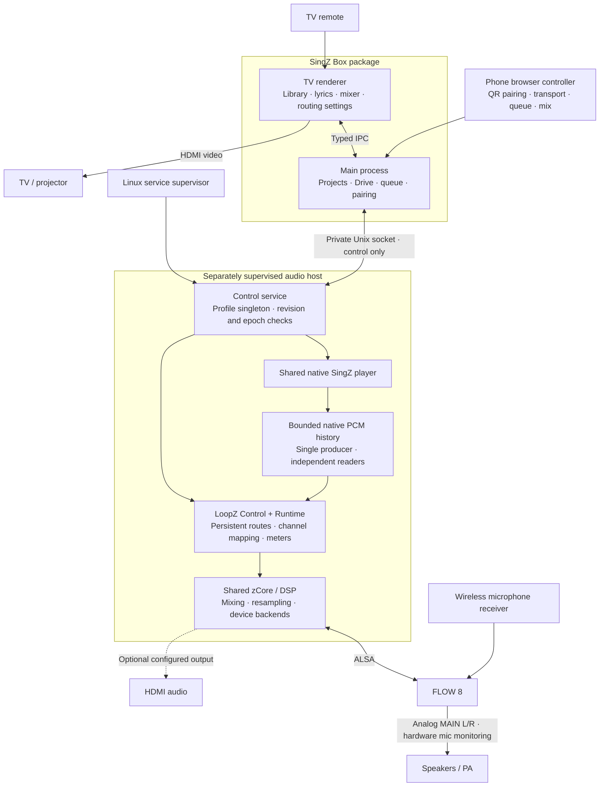

# LoopZ integration

## Goal and boundary

SingZ Box consumes a pinned LoopZ routing runtime through one shared zCore
build. A separately supervised, headless Box audio host owns physical devices,
route documents and native song rendering. The TV renderer is a control client;
its lifetime must not own enabled routing. Desktop and mobile retain their
existing audio paths.

The default appliance topology remains USB song playback into FLOW 8, hardware
microphone monitoring and analog MAIN L/R to the amplifier. HDMI carries video.
Software microphone routes are optional and must not create a return-feedback
path or duplicate an input already owned by analysis.

## Runtime architecture

The phone has no routing-admin lane. Native PCM stays inside the audio host.
Physical presentation metadata maps the producer timeline back to lyric time;
invalid or missing history makes that estimate unavailable. Private microphone
analysis borrows a read-only LoopZ input subscription. It shares the physical
capture with public routes and returns scalar levels/pitch through the private
client channel; microphone PCM stays native.

## Milestones and ownership

1. Coordinator: pin clean dependencies, verify SDK consumption, provision the
   integration worktree and maintain native artifact provenance. Keep Box PR145
   unchanged. Rebuild every native consumer after the zCore layout update.
2. Native worker: driverless prepared-song producer/history, LoopZ-owned device
   runtime and native control bridge. SDK worker: reusable Control construction
   with a preconfigured Runtime; retain its persistence/acknowledgement behavior.
3. Service worker: independent headless host, private bounded socket, client
   reconnect/uncertainty handling and separate public-routing/private-capture
   lifetimes. Coordinator: packaging, trusted TV routing controls and settings.
4. Coordinator and independent reviewer: integration tests, Linux x64/ARM64
   builds and qualification. Live hardware testing uses an exclusive window and
   preserves the current TV, VNC, kernel, firmware and mixer configuration.

## Native contract

- Link `LoopZ::Runtime` and reusable `LoopZ::Control` against the exact same clean
  zCore checkout. Do not weaken source-overlay rejection or copy dependency DSP.
- Register a fixed stereo `native:singz` source before Control restores desired
  routing. Prepared song/cue rendering feeds a bounded native AudioHistory.
- Destructive native playback rendering happens once per produced block.
  Fanout uses independent non-destructive readers; PCM never crosses control
  messages or JavaScript. Keep song gain/boost separate from router send gain.
- Native addon methods: `boxRoutingInitialize(statePath)`,
  `boxRoutingRequest(json)`, `boxRoutingPoll()`, `boxRoutingCapabilities()` and
  `boxRoutingShutdown()`. The source-level SDK is rebuilt, not treated as ABI.
- Preserve old routes on failed replacement. Persist desired intent before
  committing the prepared native scene. Expose desired and active generations,
  explicit pending/offline state and unavailable meters rather than fake success.

## Timing and lifecycle

The selected primary physical output supplies the presentation clock. A wrapper
records the provider's callback anchor without changing the block. For the
pinned runtime, source content time is the physical callback presentation time
minus monitor history delay and the public scene lookback. The monitor delay
already includes its queue/period/filter/reserve budget; do not add queue latency
again. Keep a coherent producer timeline across pre-roll, pause, seek, loops,
scene publication and stream generations. ALSA's estimated timestamp must not
be labeled hardware-certified. Incoherent or missing source history makes
presentation unavailable.

Routing lifecycle, mutation, polling and presentation queries share one serialized
control owner. Only the bounded metadata recorders and atomic health getters are
callback-safe; the presentation query samples the clock and scans retained state.
A lost journal reservation latches presentation unavailable until a full worker
drain/restart, while audio routing continues.

LoopZ Control holds an advisory lock on `<statePath>.lock` for its lifetime.
When another owner holds it, initialization fails with that error and the saved
routing is left untouched; only an unrestorable file is moved aside as
`<statePath>.corrupt-<ms>`. Automatic activation retries after a failure are
throttled to 2 s inside Control. A capture that delivers nothing for 2 s is
reopened, with backoff to 32 s while it keeps stalling. On Linux the mix
renderer asks for `SCHED_FIFO` 19, below zCore's ALSA I/O threads (20) and above
the song producer (18). It keeps normal scheduling when `RLIMIT_RTPRIO` does not
allow that (see the opt-in drop-in in [packaging](packaging.md)).

Song stop/change detaches or silences only the song producer. Enabled routes
remain alive. TV renderer reload, owning-window destruction and Box main exit
must not terminate the independently supervised host. Explicit host stop drains
callbacks before destruction. Private analysis/recording remains client-owned.
If a routed hardware input cannot be shared with the old analysis path, reject
the competing request rather than open the PCM twice.

## Client and permission contract

`--box-audio-host` starts the dedicated host without a browser window. Its
private Unix socket has a private parent directory and owner-only access. The
Box client is selected through `SINGZ_BOX_AUDIO_SOCKET`; unrelated Desktop and
preview configurations keep their existing path. A missing service never starts
a second device owner as a fallback.

All mutations are serialized and generation/epoch checked. After a lost reply,
keep the service alive and treat the result as uncertain until canonical state
is read; do not blindly replay a start or routing edit. A new service epoch does
not authorize replay. App quit disconnects its client, not the daemon. Existing
phone guests keep their transport/mix/queue scope; trusted owner routing is a
separate TV operation.

## Acceptance

- Exact clean source pins and one shared zCore target; wrong/dirty pins and source
  overlays fail. Native artifact identity includes every linked routing input.
- Native prepared playback, pause/seek/loop/master/stem controls and teardown keep
  their existing semantics. Two source readers do not advance playback twice.
- Stale generations cannot replay previous-song history. Route replacement
  failures retain active audio. Mic route identity survives song stop/change.
- Synthetic output-clock tests cover queue variation, estimated/invalid anchors,
  fanout, pre-roll, seek/loop and primary-output changes without double latency.
- A real host survives client/UI restart; routing persists across host restart;
  stale/uncertain commands and input ownership conflicts fail safely.
- Existing Desktop/Box/Drive/cache/queue/phone behavior passes. Build Linux x64
  and ARM64 packages on the Debian 13/Clang 21 stand before coordinated hardware
  qualification. Short silent checks do not qualify audibility or endurance.

## GPUI integration boundary

The native GPUI application is being developed in parallel. This integration owns
LoopZ routing and the shared native player seam, not another port of its project,
Drive or UI services. `box_routing_owner.h` and `loopz_source_backend.h` are C++
interfaces independent of Electron; N-API is one adapter. A GPUI native host must
initialize the routing owner before constructing playback and use its driverless
song backend rather than opening a second platform output.

The present headless Electron host is transitional. Replacing the TV renderer
alone keeps that runtime; a fully native product also replaces the host adapter
and its supervision entry point while retaining LoopZ, zCore, source histories,
presentation mapping and revision semantics. The current versioned socket is an
audio control contract, not a complete projects/Drive/queue application API.

## Initial implementation boundary

The service and routing settings are opt-in through the packaged support launcher.
The ordinary launcher retains its existing audio path until deployment is
qualified. Settings can create the song route, change its first monitor's output
and stereo pair, control existing sources, and explicitly add a separate-interface
software microphone route. Apply preserves unrelated routes; Cancel discards
local drafts. Same-interface microphone returns are rejected to avoid an obvious
feedback path, but this is not a proof against feedback in external cabling.

Closing an explicitly configured persistent-host TV session drains admitted
commands and detaches its local player without pausing or unloading the public
song. Ordinary Box and Desktop close their audio normally. Qualification must
exercise the real window-close path; a socket-disconnect test alone does not
exercise renderer transport teardown.

After a native prepare succeeds, main validates the project in the background
and associates a service-lifetime project descriptor with that host epoch and
generation; a failed association is logged and leaves native playback intact.
A fresh TV session reads the authoritative reconcile snapshot and, when the
epoch and generation match a commandable running or paused transport, performs
a read-only reattach: it restores the real project, synchronized lyrics,
current native controls and position without open, reprepare, Play or Settings
replay. Missing or stale metadata, changed project files, invalid lyrics or a
non-commandable host instead show a remote-scoped notice with Refresh and an
explicit Stop before another project opens. Stop is checked against both
service epoch and native generation inside the host's serialized queue, so a
restarted host reusing a counter cannot stop a different song. Recovery does
not survive a hard kill, native host restart or power cycle; see
[runbook.md](runbook.md) and AUDIO-01 in [spec.md](spec.md).

## Microphone input subscriptions

The input list uses LoopZ's physical inventory rather than the driverless song
producer's deliberately input-free inventory. Device/channel selection changes
only a draft. Start analysis explicitly acquires the chosen input; Stop retires
that private reader. Hardware microphone monitoring continues independently, and
selection/analysis never creates an audible microphone route.

The reusable native API is AudioRuntime::acquireInput(explicitUid, capacity),
releaseInput(id) and inputStatus(id). A subscription borrows an AudioSource with
an independent read cursor. The Box analysis worker must stop and join before
its control owner releases that subscription. Public routes, private readers
and retired scenes share one physical capture. Wider live profile changes fail
explicitly instead of reopening an input behind another reader. The initial
private API requires an explicit UID and excludes simultaneous default-input
aliases. Native subscription and channel budgets remain enforced.

BoxInputCapture reads native history on a fixed 48 kHz analysis grid. Its
lookback is 2048 frames, with at most another 2048 frames of scheduling
backlog recovered in batches of four blocks. Brief late wakes preserve the
fixed sample grid; a real skipped-history boundary increments the private
reader overrun count and resets analysis. These are consumer buffering and
scheduling budgets, not hardware latency measurements.
Metadata is explicitly estimated and does not claim a physical source-frame
counter. Missing/offline history is unavailable rather than fabricated silence;
stream/history boundaries reset analysis continuity. A successful start can
report starting before sufficient history exists. The client observes the same
generation until running, with bounded readiness/recovery deadlines and exact
owned cancellation; uncertain replies never authorize automatic replay.

Only scalar per-channel peak/RMS snapshots and selected-channel analysis cross
IPC. Old bindings without the optional microphoneLevels capability are shown as
unavailable. Freshness and ownership generation gate every displayed level.
Settings, player and mixer use the same fresh, owned input levels. Mixer
meters observe physical inputs 1/2; microphone gain and mute remain hardware
controls unless an explicit software monitor is configured.
Analysis survives page navigation and song changes; app closure drains its
private capture without stopping enabled public routes. Raw microphone relay
through the legacy monitor path remains unavailable; create an explicit routing
monitor only when software monitoring is intended.

General matrix editing and choosing an arbitrary primary monitor are outside
the initial TV editor; presentation uses the first enabled song-bearing monitor
in saved document order.

Concurrent hosts are excluded both by the service profile singleton and the
private socket. An existing socket is never probed and removed on startup.
Supervised restarts clean the private runtime directory; manual recovery first
requires proving that the previous host stopped.

## TODO: capture-clock microphone analysis

- [ ] Replace Box's independent, fixed 48 kHz analysis-grid reads with a
  frame-based subscription to the original capture samples. Compute peak/RMS
  and pitch from enabled channels without sinc resampling when the analysis
  accepts the capture sample rate. This is planned work, not implemented.
- [ ] Retain LoopZ's single ownership of physical capture; add a bounded,
  independent source-frame cursor/tap rather than opening another ALSA stream.
  Preserve sample order, source rate, stream generation and timestamp mapping.
- [ ] Map capture-frame timestamps to the song/presentation timeline for scoring
  and display. Handle drift through clock mapping, and use the appropriate
  source-rate estimate for analysis; equal nominal 48 kHz rates do not establish
  a shared clock.
- [ ] Preserve explicit start/stop, enabled-channel selection, unavailable-level
  semantics, cancellation and teardown. Detect overwritten history, gaps and
  device restarts, and reset analysis continuity without fabricating samples.
- [ ] Keep resampling for routes crossing independent device clocks (for example,
  FLOW 8 capture mixed into HDMI playback) and consumers requiring another rate.
- [ ] Add regressions for frame continuity, sparse channels, drift/timestamp
  alignment, overrun/reconnect and lifecycle; prove the native-rate analysis path
  does not invoke the resampler. Compare pitch/meter accuracy and latency, then
  measure unprofiled audio-host CPU on the Pi with two enabled FLOW 8 channels
  under matched workloads. Do not assume CPU savings before measurement.

Recorded 9 November 2026 as a deferred performance task. The fixed-grid behavior
in the current microphone subscription contract above remains in effect until
this task is implemented and qualified.
