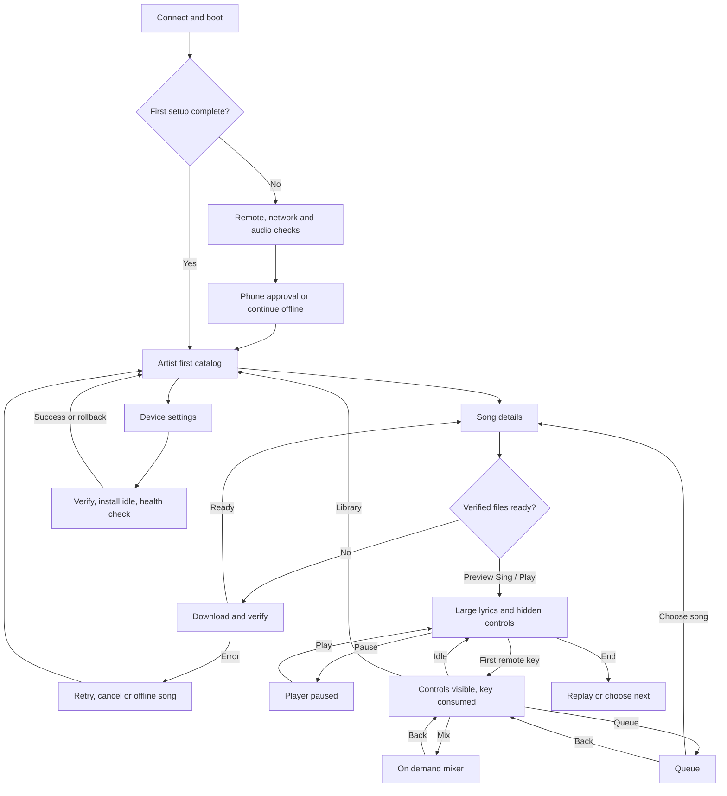

# SingZ Box product and interaction specification

Method: specification-driven development (SDD).

SingZ Box is a separate karaoke appliance application for a TV and a remote. This
specification connects the customer journey, screen contracts, system boundaries,
and executable acceptance scenarios. The design uses the current Desktop SingZ
interface and real UIKit, adapted for a fixed UHD frame and remote navigation.

The [design plan](redesign-plan.md) defines the composition and interaction rules.
[Full prototype coverage](full-prototype-coverage.md) describes the simulated
design reference, while [the implementation map](cjm-implementation.md) records
production behavior and remaining qualification. The [historical prototype
audit](prototype-audit.md) explains design gaps that shaped these contracts.

## 1 Scope and decision status

### Product requirements

| ID | Requirement |
| --- | --- |
| BOX-01 | Box has its own TV UI, navigation and device settings. Desktop SingZ keeps its normal UI. |
| BOX-02 | Share project, track, editing, splitting, library/Drive and audio logic where applicable; sharing only DSP and visual primitives is insufficient. |
| BOX-03 | Use the real SingZ UIKit, palette and the desktop's exact font assets. TV sizing may differ. |
| BOX-04 | Catalog is a flat, compact list with subtle dividers and clear amber focus; no decorative waveform thumbnails. |
| BOX-05 | Catalog order is Artist, Song, Key, Tempo, Vocal range, Time, optional state icon. Availability needs no text column. |
| BOX-06 | Singing shows large synchronized lyrics. Mixer appears only on demand. |
| BOX-07 | Playback controls hide after five idle seconds during singing. First remote press only reveals controls; its repeats and release cannot trigger an action. |
| BOX-08 | Every essential TV task works with directions, OK and Back. A keyboard or mouse is unnecessary. |
| BOX-09 | Phone approval handles account sign-in; TV does not require a browser window or credential entry. |
| BOX-10 | Device settings include network, audio routing, microphones and system updates with rollback. |
| BOX-11 | Every TV screen uses the same 3840×2160 UHD canvas and 16:9 aspect ratio. Smaller previews uniformly scale that canvas; routes never resize the TV frame to their content. |

BOX-01–11 record requested behavior, not a claim of implementation or final visual
approval. Proposed details below are implementation contracts for review. Changes
to them must update requirement IDs, acceptance cases and prototype evidence together.

### Delivery slices

| Slice | Included | Completion evidence |
| --- | --- | --- |
| Design baseline | All journeys, screen states, remote rules, recovery behavior | This spec, screen inventory, screenshots, gap report |
| First functional Box | Prepared local/Drive projects, verified download, offline open, playback/lyrics/mix/queue, persistent settings | Remote-only installed-app tests plus native audio receipts |
| Appliance completion | First setup, phone controller, hardware routing, kiosk recovery, signed automatic updates/rollback | Real board/TV/FLOW 8 and failure-injection tests |
| Shared authoring follow-on | Import, splitting and editing services shared with desktop; phone/desktop preparation flows | Shared-service integration and project round trips |

All slices belong to the full journey. Missing later screens remain design gaps,
even when their runtime implementation is scheduled after first playback.
Local splitting belongs to normal desktop SingZ; a full TV editing surface is not
assumed. The placement of import/split controls on Box versus its phone controller
is an open product decision, not permission to duplicate desktop logic.

### Singer-facing terms

One name per concept on the TV, in English, Russian and Simplified Chinese. The
spec's internal words (catalog, collection, library) stay in engineering text
and keys; they never appear on screen.

| Concept | On screen (EN / RU / zh-CN) | Retired names |
| --- | --- | --- |
| The list of songs on this Box (S07) | Songs / Песни / 歌曲 | Catalog, Your projects, SingZ library, Collection, Browse collection |
| The Drive sign-in and offline storage (S06, S20) | Google Drive / Google Drive / Google Drive | Collection & account, Account, Local projects |
| Output, inputs and microphones (S12) | Audio & microphones / Звук и микрофоны / 音频和麦克风 | Sound settings, Sound & microphones |
| The singer's voice track on the Main and Stems tabs | Vocals / Вокал / 人声 | Lead vocal |
| Stems ready for singing | Backing tracks ready / Минусовки готовы / 伴奏已就绪 | Prepared stems, Prepared local stems |
| The desktop app that prepares songs | SingZ on your computer | Desktop SingZ |
| Back hint on the song list | Menu | Navigation |

Diagnostics values (saved/active revision, routing source, sample-rate detail)
belong on the Diagnostics page only. Counts take the locale's plural forms
(Russian has three) and an empty count is a word ("None paired"), never "0".

## 2 Customers and success criteria

| Customer | Goal | Constraints | Success |
| --- | --- | --- | --- |
| Owner/host | Connect the box, authorize a collection, prepare an evening | Limited setup patience; TV has no keyboard | Setup completes without desktop access; usable offline afterward |
| Singer | Find a suitable song, sing and adjust accompaniment | Across the room with a small remote; may be a guest | Readable lyrics, obvious focus, no accidental action on wake |
| Second singer/guest | Join, queue songs and use the second microphone | Must not receive the owner's account credentials | Independent mic controls and revocable phone pairing |
| Maintainer/owner | Recover network/audio or a failed update | May have only the TV remote available | Previous working state and offline collection remain recoverable |

Proposed usability gate: a person unfamiliar with Box can select an offline song,
start/pause, open/close Mix and return to the same catalog row using only a remote,
without instructions from a developer. Assess physical readability from the couch
on a 1080p TV; preview screenshots alone cannot establish viewing-distance comfort.

## 3 Full customer journey map

The concern column records expected customer concerns to validate, not measured
research. Screen IDs are defined in section 5.

| Journey | Customer goal and action | Touchpoints and screens | System response and retained state | Concern and recovery | Acceptance |
| --- | --- | --- | --- | --- | --- |
| J01 Evaluate and acquire | Understand required box, TV, audio and microphones | Product/setup guide; physical connectors | Explain included hardware, USB remote fallback, HDMI and USB audio topology | Avoid buying an incompatible setup; compatible-device list needed | A01 |
| J02 Connect and boot | Connect power, HDMI and a supported audio path; optionally connect qualified wireless receivers; turn on TV | Physical setup → S01 | Show boot progress; discover devices; never start singing automatically | Is it working? Show a usable diagnostic path if boot/audio fails | A01, A02 |
| J03 First setup | Choose language, check remote and usable display | S02 → S03 | Visible initial focus, remote test, safe display scale | No mouse; Back must not strand user in an OS desktop | A02, A03 |
| J04 Connect network | Use Ethernet, or approve Wi-Fi setup on phone | S04, S18, S19, P01 | Show actual connection state; preserve old working network until new one succeeds | Wrong Wi-Fi/password or offline phone; Retry, Ethernet or offline continuation | A04 |
| J05 Check sound and microphones | Choose output, verify two microphones and level | S05, S17 | Apply routing atomically; deliberate bounded test; visible meter/error | No sound, feedback or missing device; cancel draft or reconnect device | A05, A06 |
| J06 Connect collection | Approve Drive on phone or continue with existing local songs | S06, S20, P02 | QR/link and code, approval status, cancel/expiry/retry; separate phone-remote pairing | Never type credentials on TV; denial leaves offline songs intact | A07 |
| J07 Discover and choose | Browse artist first; inspect key, BPM and vocal range | S07 → S08 | Flat catalog; remembered row; known values or unknown marker | Can I sing it? Missing analysis is not fabricated data | A08, A09 |
| J08 Prepare unavailable song | Open a Drive song and choose Sing | S08 → S09 → S08 | Download/verify stems and lyrics; show progress; enable Sing only when usable | Network/storage/integrity failure; cancel, retry or pick offline song | A10, A11 |
| J09 Start singing | Select a song, then deliberately choose Sing/Play on its preview | S08 → S10 → S11 | Open and start the chosen song with that single preview action; large lyrics; controls hide after idle | Catalog browsing is silent; failed, cancelled or superseded opens do not start playback | A12, A13 |
| J09a Lyrics unavailable | Understand missing, empty or unsynchronized lyrics | S27 → S08/S10 | Explain lyric state; offer return/retry and an explicit instrumental option if approved | Never invent synchronized text or silently present stale lyrics | A23 |
| J10 Adjust during singing | Wake remote controls; open Mix; adjust stem or mic | S11 → S12 → S13/S14 → S11 | First key only wakes; mixing retains playback; Back restores Play focus | Accidental pause/seek or wrong mic; expose labels and absolute levels | A13, A14 |
| J11 Run the evening | Queue, reorder, remove, select next song | S15, S08, S10 | Queue stays stable during preparation and navigation; explicit Next action (starts the next queued song) or explicit queue pick (opens paused) | Avoid missing/duplicate entries or unrequested autoplay | A15 |
| J12 Pair a phone/guest | Scan a remote pairing QR and approve access | S16, P03 | Scoped pairing, expiration, revocation; guest can control allowed functions | Pairing must not grant account tokens or owner-only settings | A16 |
| J13 Finish and return | Finish a song; replay, choose next or browse | S10/S15/S07 | Stop at end; show controls; no autoplay; focus "`Next: <song>`" with Replay beside it, or "Choose a song" when the queue is empty; Next starts the next queued song and removes the finished one from the queue; retain song settings | Song ended—what next? Focus on an enabled action | A17 |
| J14 Use offline and recover | Lose network/device, restart UI or power cycle | S07, S21, S22 | Verified songs remain usable; persist approved state; truthful degraded indicators | Do not lose collection or switch to an unexpected audible route | A18, A19 |
| J15 Maintain and update | Inspect update; automatic check/stage; accept idle install | S23–S25 | Verify signed image; avoid active session; reboot with health check and rollback | Power loss/bad image; retain data and previous bootable system | A20, A21 |
| J16 Next session | Turn on and resume browsing | S01 → S07 | Restore preferences, collection and valid sign-in; playback stays stopped | No repeated sign-in for a valid session; stale authorization offers reapproval | A18 |
| J17 Account/device handoff | Unpair a guest, sign out or reset box deliberately | S20, S26, P03 | Confirm scope; revoke pairing/authorization; distinguish local cache from cloud data | Never delete cloud projects as a side effect of local cleanup | A22 |

### Journey flow



## 4 Interaction and visual requirements

### Remote and focus contract

| ID | Rule |
| --- | --- |
| NAV-01 | Exactly one enabled actionable target has visible focus when controls are shown. No focus loss to the page body after completion, cancellation or reflow. |
| NAV-02 | Catalog Up/Down moves one row; boundaries do not wrap unexpectedly. Back from song detail restores the same row. Back at catalog focuses primary navigation. |
| NAV-03 | Header Left/Right selects adjacent navigation buttons; Down enters the remembered content target. Selection and focus are distinct. |
| NAV-04 | Settings directions follow the visible rows; every routing option reaches Apply/Cancel with directions alone. Native range Left/Right changes its level. |
| NAV-05 | Dialog focus is contained; Back closes only the topmost dialog and restores a valid target. First Back in a visible player Mix returns to Play, not to catalog. |
| NAV-06 | Hidden player controls wake on any app-owned remote key. Consume that keydown, repeats and matching keyup; never pause/seek/open a dialog/leave the player from the wake sequence. A later distinct press acts normally. |
| NAV-07 | Hide after 5 seconds with no input while actively playing and no dialog. Never hide during a held key, pause, end-of-song or mixer interaction. Idle starts again after interaction/dialog closure. |
| NAV-08 | Map physical CEC/HID buttons to logical directions, OK, Back and MediaPlayPause. Do not intercept OS-reserved combinations. Reconnect must not replay stale presses. |
| NAV-09 | Returning from hidden playback, app visibility recovery or natural song end restores Play focus. Focused rows scroll into view without changing selection. |
| NAV-10 | Left/Right on the player seek bar only seek, also at its ends and when the end is reached; focus leaves it with Up/Down only. A queued row's actions are reached with Right (footer hint `→ Actions`) as well as Down. Back from a Settings sub-page returns to the row it was opened from; the "Setup, remote & display" row opens at the language step. Next/Sing from the player keeps the player on screen while the song opens. |

Verify the idle deadline with input between transport updates, not only aligned
to them. A coarse playback clock must not determine the five-second deadline.
Wake acceptance includes overlapping keys, unrelated releases, stale repeats
after recovery and natural end during a held wake sequence. A deliberate wake
fallthrough must fail the same check that protects normal playback/navigation.
The player owns transport independently of catalog/queue focus. Inactive player
surfaces must not intercept navigation or restore focus over another screen.
Focus restoration reads the latest transport state after setup/recovery updates;
cover missing-lyrics → Catalog → ready song entry as a regression.

### SingZ visual contract

- Import actual UIKit components and `kit.css`. Assign its font variables to the
  exact desktop default font imports: Bricolage Grotesque Variable and Martian
  Mono Variable (`wght-normal`, not a different variable-axis asset variant).
- Use UIKit night palette: background `#12100d`, panel `#1b1814`, text `#f4efe6`,
  amber accent `#ffa028`; standard UIKit stem colors retain their meaning.
- Catalog is a continuous list with aligned columns and thin separators. Artist
  precedes song. No card grid, waveform artwork or availability word column.
  State icons must have an accessible name; their absence must not hide a required action.
- Display song key as tonic and mode, tempo in BPM, and vocal range as low/high
  scientific pitch notes. Unknown data is `—` with an accessible explanation.
  Range describes analyzed lead vocals, not a claim about the customer's range.
  Show original analysis separately from any applied transposition.
- Lyrics retain the actual SingZ per-word amber-to-ivory sweep, weight 650 and
  width setting 92. Current-word glow is fixed, not a pulsing whole-line effect.
  Large TV type must not cause horizontal clipping or destroy read-ahead.
- Use visible amber focus in addition to selected styling. Never depend solely
  on hover, color or tiny status text for an essential operation.
- Render every route and dialog on one **3840×2160 UHD, 16:9** screen.
  Preview widths such as 1024, 736 and 320px scale the entire TV frame uniformly;
  they do not switch to mobile layouts or change the screen height. Keep chrome
  anchored and scroll long content inside the screen with remote focus.
- The prototype uses a 1600×900 density coordinate system enlarged by 2.4 into
  the 3840×2160 canvas. This gives 48px catalog titles at native 4K and preserves
  the same relative typography in every preview. Phone-controller pages remain
  a separate responsive product surface. Physical couch readability still needs
  a real TV check; a 4K screenshot is not hardware qualification.
- Translated labels, Cyrillic/CJK font fallbacks, long names and reduced motion
  must retain all actions. Do not shrink metadata indefinitely to fit columns;
  reflow instead. Resolve exact supported launch locales before release.

## 5 Screen and state contracts

Each entry lists intended product states, including those not yet prototyped.
A screen is not complete until its entry, exit, focus and failure states are covered.

| Screen | Content and states | Primary action and initial focus | Back and recovery |
| --- | --- | --- | --- |
| S01 Boot/readiness | Boot, audio service starting, ready, recovery | Continue when ready; diagnostics after failure | Retry without OS shell |
| S02 Welcome/language | New owner, language choice, returning setup | Selected language → Continue | Earlier setup step, no account loss |
| S03 Remote/display check | Remote directions/OK/Back recognized; safe scaling | Confirm display and remote | Restore safe display scale |
| S04 Setup network | Connected, scanning/setup, connecting, failed, offline | Connect or Continue offline | Preserve previous working link |
| S05 Setup audio | Available devices, missing FLOW 8, output/mic test | Test deliberately, confirm routing | Reconnect or keep previous route |
| S06 Drive authorization | QR+URL+code, pending, approved, denied, expired, canceled, offline | Start/renew approval | Cancel returns to usable offline collection |
| S07 Catalog | Loading, flat list, empty, offline, stale, unavailable; metadata unknown | Remembered song, otherwise first row or empty-state CTA | Primary navigation |
| S08 Song details | Artist/song, metadata, ready/needs preparation/unavailable | Sing if ready; otherwise Prepare; Add to queue | Same catalog row and scroll |
| S09 Preparation | Download, verify, ready, canceled, retry, no space, corrupt or unsupported | Cancel while busy; Retry on recoverable failure | Stop task safely; preserve existing verified files |
| S10 Player controls | Paused, playing-visible, ended, error | Play/Pause; seek, Mix, Queue, Library; Up next line and Next (at end: Next with Replay beside it) | Leave player deliberately; preserve settings |
| S11 Singing | Three contextual large lyric lines, progress by words; controls hidden | Wake-only first key | First Back wakes; next Back can leave |
| S12 Wake transition | Controls visible, wake sequence consumed until release | Play/Pause focused | No action from held wake repeats |
| S13 Mix main | Master, lead vocal, microphones 1 and 2; mute/solo/absolute level | Main tab or remembered active channel | Play focus; playback continues |
| S14 Mix stems | Six stems with M/S/level, absent stem explained | Remembered channel; labels never ambiguous | Same as main mix |
| S15 Queue | Empty, populated, reordered, preparation pending, next choice | First enabled queued song or Browse | Return to source context; queue pick opens paused without consuming; only the explicit player Next action consumes (the song that just played) |
| S16 Phone pairing | QR/link+code, pending, paired, expired, revoked | Pair/renew or Unpair | Preserve independent Drive account state |
| S17 Sound settings | Draft output/mic routes, test, applying, applied, failed, disconnected | Back or first setting; Apply and Cancel | Discard draft on cancel; preserve effective route on failure |
| S18 Network settings | Actual link status, switching, failed, reconnect | Existing connection or setup action | Preserve offline music; confirm disruptive switch |
| S19 Phone network handoff | Reachable setup URL/QR, code, completion, expiry, phone unreachable | Renew or Done when verified | Network settings |
| S20 Account | Actual account state, reconnect, sign out, cached-library scope | Connect or manage authorization | Settings; local/offline access stays coherent |
| S21 Offline/storage recovery | Network unavailable, no space, corruption, offline-ready alternatives | Retry, storage management or offline songs | Return to originating song/context |
| S22 Audio/UI recovery | Missing device, service error/restarting, UI reconnection | Reconnect/retry; no surprise playback | Last valid catalog/player context |
| S23 System/update summary | Current/previous versions, checking, update ready, staged, deferred | Check or schedule idle install | Settings; postpone active-session disruption |
| S24 Update confirmation/progress | Scope, restart warning, verifying, installing, rebooting, failed | Install only if eligible; Cancel before commit | Safe cancellation; after commit explain waiting/recovery |
| S25 Rollback/recovery | Boot health failure, automatic rollback, restored version | Continue/retry after known good boot | Data and auth remain usable |
| S27 Lyrics recovery | Missing, empty, timing unavailable or visibly out of sync | Return, retry lyrics preparation; instrumental continuation needs explicit product approval | Song details; no fabricated timings |
| S26 Ownership/privacy reset | Sign out, revoke phones, clear local cache, factory reset | Least destructive action; explicit confirmation | Cancel is initial safe choice |
| P01 Phone network setup | Discover box, choose network, submit secret, verify result | Connect, retry or cancel | Never require password entry on TV |
| P02 Phone account approval | Provider URL, approve/deny, return to TV | Provider-owned approval | Denial/expiry safely visible on TV |
| P03 Phone controller | Paired connection, catalog/queue/transport/mix, reconnect/revoke | Authorized control | Owner credentials never exposed |

## 6 Functional and service contracts

| Requirement | Contract |
| --- | --- |
| LIB-01 | Project IDs and metadata come from shared application services. Missing analysis remains unknown; original audio is optional when required stems and lyrics are valid. |
| LIB-02 | Catalog loading/error/empty/offline states are distinct. Authorization does not fabricate songs; cached rows can remain visible with truthful availability. |
| PREP-01 | Preparation is cancellable and generation-scoped. Old task completion cannot open or overwrite another selected song. |
| PREP-02 | Verify required files before publishing ready state. Atomic local availability survives reboot; partial downloads do not become playable projects. |
| PREP-03 | Cache removal affects this box only. A partial TV collection cannot delete desktop or cloud projects. |
| PLAY-01 | Catalog selection opens a silent preview. Its explicit Sing/Play action opens and starts the chosen song once without another Play press; generic project opening and queue-only selection may still open paused. Failed, cancelled or superseded start intents never start a different song. Play/Pause UI, authoritative audio transport and lyric time agree. Seek and end-of-song restore coherent focus. |
| PLAY-02 | On-demand mixer changes the intended stem/mic only and does not pause transport. State survives close/reopen and, after qualification, restart. Stepped dB sliders render values aligned to their step grid; saved gain and its readout stay exact until user input. |
| PLAY-03 | Queue browsing preserves the current transport. Back returns to the current song's lyrics and Play focus. Reordering/removing entries never changes active playback; replacing the active song is deliberate. |
| PLAY-04 | Lyric highlighting uses the shaped text’s measured geometry with a continuous amber edge and glyph-shaped bright core/glow. Seconds and 3/2/1 dots sit just above the lyric line they lead into and guide vocal entries through intros and instrumental gaps independently of audio metronome settings; they hide while paused. Painting pauses under dialogs and resumes at the current accepted song time. Very long wrapped single tokens retain readable text when single-run masks cannot represent them. |
| QUEUE-01 | Next is an explicit player action: it starts the next queued song (mid-song only after the switch confirmation; directly once the current song has ended) and removes the song that just played from the queue (when it was queued) once the next one opens. Choosing a song from the queue opens it paused and consumes nothing; remove is explicit. Nothing advances by itself: no autoplay at song end. If autoplay is added, specify consent, failure and consumption rules first. |
| AUDIO-01 | UI restart/reconnection reads authoritative audio state instead of restarting playback or restoring stale levels. Opt-in persistent Linux Box implements this with an independent native audio host/socket, a service-lifetime project descriptor and read-only reattachment to the same host epoch and generation for a commandable transport on a running host (playing, pre-roll, paused, stopped before first Play, or completed); Refresh is safe while retained, and explicit Stop is the controlled fallback that must confirm release of the reviewed identity. Microphone analysis is host-owned and always on while any input is enabled: it starts with the host from a persisted selection, survives UI close/restart without any command, retries unavailable devices, and stops only when all inputs are turned off. The TV shows Off, Starting…, No input or Unavailable (a real fault) instead of waiting for a Start press. |
| AUDIO-02 | FLOW 8 USB and HDMI are explicit output choices. Mic 1/Mic 2 route independently. No automatic loud-route fallback after unplug. |
| AUDIO-03 | Proposed initial mix controls change local DSP levels. Hardware FLOW 8 control is a separate adapter capability; relative commands require fresh qualified readback or explicit takeover. Stale requested values must not raise volume after a physical fader move. |
| AUDIO-04 | A persistent Box-wide metronome override either follows song settings or suppresses both clicks and audio count-in for current and future songs, without rewriting project preferences. Policy changes pause playback and require audio acknowledgement; failures do not silently restore audible song cues. |
| AUTH-01 | Phone controller pairing and Drive authorization are independent revocable sessions. TV shows public codes/URLs only; secrets stay in trusted services. |
| STORE-01 | Persist effective audio routes, approved account state, verified project availability and per-project stem preferences atomically. Queue persistence is proposed on the same box; no cloud queue sync implied. |
| NET-01 | Network status reflects service results; choosing Wi-Fi is not equivalent to successful connection. Preserve a recovery link or offline continuation. |
| UPDATE-01 | Automatic checking/staging uses signed, target-matched images; installation/reboot waits until idle or owner confirmation. Active singing/monitoring prevents an unannounced reboot. |
| UPDATE-02 | Failed installation/boot must recover the known good system and retain user data. Proposed implementation: A/B boot health validation selects the new image only after success and rolls back automatically on failure. Reject rollback-incompatible data migration before installation. |

### Proposed application boundaries

```text
TV app / phone controller
    → shared project, library, Drive, preparation and editing services
    → native audio service (playback, DSP, capture, analysis)
    → Box platform adapters (network, device discovery, pairing, updates)
```

Box owns remote navigation and appliance screens. Shared domain services own
project rules, preparation and editing behavior. Reuse UIKit rather than copying
its components. Repository topology is not decided by this spec; no migration is
required to review or implement the first shared service boundary.

Events need stable project/task IDs and revisions. UI commands should return an
accepted/result/error state, not optimistic success with no authoritative reply.
Subscription reconnection fetches a complete current snapshot before relative
operations resume. Recovery copy must identify the affected task and a usable action.

## 7 Acceptance scenarios and traceability

These are the implementation contract. A prototype interaction pass does not
prove a service or hardware scenario. Audit case IDs and evidence live separately.

| Case | Given | When | Then | Requirement/screens |
| --- | --- | --- | --- | --- |
| A01 Physical startup | Supported box/TV/audio/remote connected | First power-on | Visible readiness or actionable recovery; playback stopped | BOX-01/08, S01 |
| A02 Setup remote only | Fresh box | Owner completes setup with remote/phone | No mouse, OS window switching or TV credential entry | NAV-01/08, S02–S06 |
| A03 Focus and scale | Any supported viewport/locale | Move, open, return, reflow | Enabled visible focus; labels/actions fit; every TV capture is 3840×2160, previews remain 16:9 and navigation targets remain identical under scale | BOX-03/08/11, NAV-01–05 |
| A04 Network failure | Working old connection or cached songs | New Wi-Fi fails | Prior connection or offline path remains; failure is truthful | NET-01, S04/18/19 |
| A05 Draft routing | Known effective output/mic routes | Change draft then Cancel/Back | Effective routes unchanged; reopening shows effective values | AUDIO-02, S17 |
| A06 Route failure | FLOW 8 disappears during Apply | Service rejects draft | No false Applied state, surprise loud fallback or lost recovery control | AUDIO-02, S05/17/22 |
| A07 Phone authorization | Unauthorized, denied, expired or canceled session | Approval succeeds/fails/races cancel | Only live approval signs in; retry works; offline library survives | AUTH-01, S06/20, P02 |
| A08 Catalog order | Collection has analyzed and unknown metadata | Browse | Artist first; song/key/BPM/range/time; optional accessible state icon | BOX-04/05, LIB-01, S07 |
| A09 Catalog transitions | Loading/empty/error/offline collection | Service changes state | Truthful screen, actionable fallback, stable remembered row | LIB-02, NAV-02, S07 |
| A10 Prepare/retry | Drive-only song | Prepare, fail, retry | Progress, enabled Cancel/Retry, verified ready; preview Sing opens and starts playback | PREP-01/02, S08/09 |
| A11 Cancel race/storage | Preparation in progress | Cancel, switch song, corrupt file or fill storage | Stale completion ignored; no partial-ready state; verified older copy safe | PREP-01–03, S09/21 |
| A12 Play from ready | Stems and lyrics exist without original | Select catalog song; choose Sing/Play on preview; seek; pause | Preview remains silent until its explicit action; that action opens and starts once, lyrics synchronize, controls agree | PLAY-01, S08/10/11 |
| A13 Idle/wake | Singing, controls visible | Idle ≥5s, then Enter/Back/direction/media held | Hidden controls cannot act; first sequence wakes only; next press acts | BOX-07, NAV-06/07, S11/12 |
| A14 Mix/focus | Song playing | Open Mix, alter one lane, Back | Playback continues; correct lane changes; Play focus restored | PLAY-02, NAV-04/05, S13/14 |
| A15 Queue lifecycle | Ready and Drive-only queued songs | Reorder/remove/open/prepare/cancel | Explicit ordering/removal; queue pick opens paused, no consumption; Next starts the next song and removes the one that played; no autoplay | QUEUE-01, S15 |
| A16 Guest separation | Owner Drive signed in | Pair/revoke phone | No credential leakage; revocation prevents later commands; Drive remains signed in | AUTH-01, S16, P03 |
| A17 Natural end | Controls hidden near song end | Transport ends | Controls show, Play focused, remote replay works; Next choice explicit (`Next: <song>` / Replay, or Choose a song when empty) | PLAY-01, NAV-09, S10/15 |
| A18 Restart/offline | Prepared song, effective routes/stems/auth saved | Restart with network absent | Verified song and preferences survive; no autoplay; expiry offers reapproval | STORE-01, S01/07/20/21 |
| A19 Audio/UI recovery | Native service playing | UI restarts or audio device drops | Reattach truthful state or expose safe recovery; no uncontrolled level restoration; microphone meters stay live across a UI restart with no input, and return unattended after an interface replug | AUDIO-01–03, S22 |
| A20 Update integrity/idle | Update staged, active song | Check/install requested or image invalid | Invalid image rejected; singing defers reboot; idle install reports progress | UPDATE-01, S23/24 |
| A21 Rollback | New image fails health check or power interrupted | Reboot/recover | Known good boot selected, data retained, TV explains recovery | UPDATE-02, S25 |
| A23 Lyrics recovery | Song has missing, empty or unsynchronized lyrics | Open or detect bad timing | Explain the state, offer return/retry; no fabricated synchronized lyrics; instrumental option follows the resolved policy | LIB-01, S27 |
| A24 Shared behavior | Desktop and Box use the shared project services | Round-trip project metadata/track edits and invoke preparation/splitting through their supported entry points | Same shared invariants and stem/lyrics results; no duplicated Box-only domain implementation; desktop behavior preserved | BOX-02, LIB-01 |
| A22 Owner handoff | Phones/accounts/cached projects exist | Sign out/clear cache/reset | Confirmed scope only; cloud collection untouched; phones revoked when requested | PREP-03, AUTH-01, S26 |

### SDD implementation loop

1. Choose a requirement and journey; resolve its open decisions.
2. Update screen/state contract and Given/When/Then acceptance case first.
3. Prototype normal, empty/loading and relevant failure states.
4. Run remote-only and visual checks; link evidence to the same IDs.
5. Implement shared service/platform behavior; add meaningful failure regressions.
6. Qualify the installed application and hardware where required.
7. Mark the requirement satisfied only when its required evidence passes. A
   design review or simulated timer cannot satisfy a native-audio/update case.

## 8 Open decisions and release gates

| Decision | Proposed default / required resolution |
| --- | --- |
| Long collections and viewing distance | Fixed 4K frame is confirmed; qualify its density from the couch and choose paging/search for large collections without credential typing |
| Queue end behavior | Explicit Next action or manual selection; no autoplay; approve any future alternative explicitly |
| Destructive/system authority | Owner approval for reset, sign-out, network disruption and reboot; define guest phone scope |
| Sound-test policy | Deliberate bounded test, never automatic; choose level, duration and emergency stop on hardware |
| HDMI versus PA latency | Qualify each supported route; measure lyric/audio alignment and TV processing delay |
| Missing/untimed lyrics | Decide whether an explicitly labeled instrumental session is allowed; no silent fallback or invented lyric timing |
| Local acquisition/splitting | Reuse desktop services; choose TV/phone entry points after prepared-project flow |
| Monitoring | Decide hardware direct monitoring versus software path per route; expose truthful availability |
| Hardware mixer ownership | Keep DSP UI independent until adapter readback/takeover semantics are qualified |
| Update/data compatibility | Define boot health deadline, retry budget and rollback-compatible data schema before A/B implementation |
| Localization and privacy | Choose launch locales, account display/redaction and owner authorization model |

Release requires all applicable acceptance cases plus real remote/TV/audio evidence.
Current prototype omissions are tracked in the audit, not silently waived here.

## 9 Source grounding

This specification records the product and interaction contracts. Implementation
must also follow [the project rules](../../PROJECT-RULES.md). Prototype fixtures
are design evidence, not authority to synthesize live service outcomes.

### Additional queue continuity contract

A15 must compare the
active song, transport and mix before/after queue navigation, reordering/removal
and Back. Selecting another song from the queue requires an explicit switch; it opens paused and consumes nothing.
The player Next action is the exception: it starts the next queued song (after the switch confirmation mid-song, directly once the song has ended) and removes the song that just played from the queue once the next one opens. Autoplay remains a separate proposed policy; nothing advances without Next.
