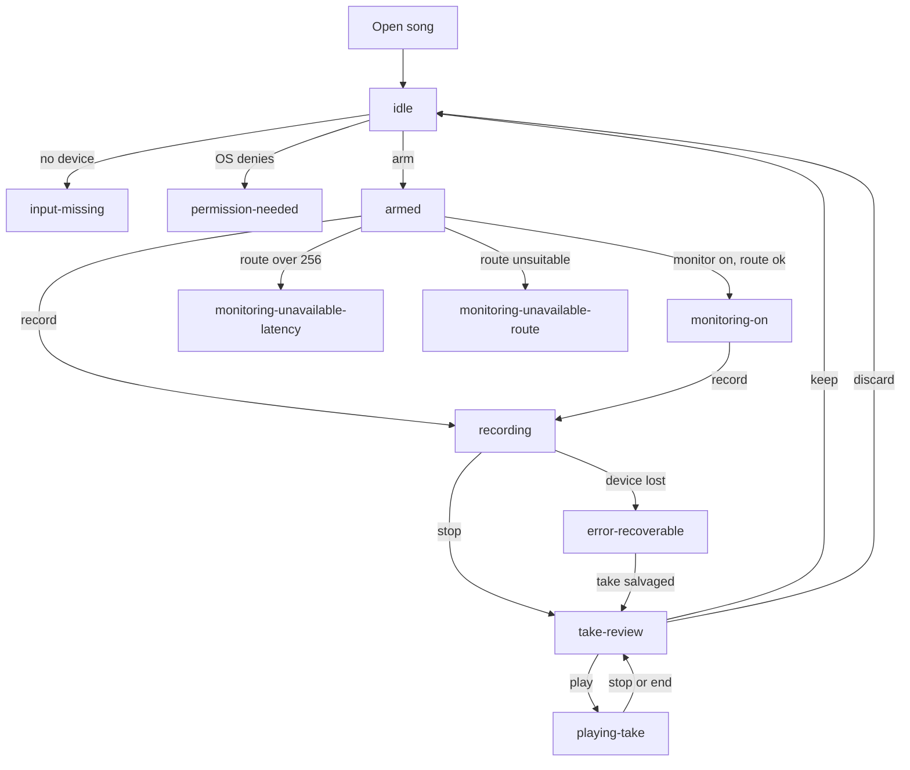

# SingZ Voice strip: journey map and specification

Method: specification-driven development (SDD). Status: proposed, not implemented.
Authority: [ADR 0014](../../adr/0014-voice-strip.md) owns the product rules and
milestones; this document derives journeys, UI states and testable requirements
from it. If they disagree, the ADR wins and this file is corrected. Origin: issue
#136 (input monitoring and recording).

Marking: text tagged **[inferred]** was not read from the ADR, code or docs; it is
this spec's proposal and needs owner review. Everything else restates the ADR or a
file read for this spec (`TrackLane.tsx`, `PitchStrip.tsx`, ADR 0010, `ARCHITECTURE.md`
custom-track section).

## 1 Scope

The Voice strip is one extra row in the song player's mixer, beside the stems. It
lets a singer who sings along to a song (in this product "lessons" means singing
along in the song player, not the Train tab) hear themselves, record a take and
play it back against the song. It is the first step toward the DAW session engine
(the destination); it is not that engine.

Controls on the strip: input selector (device and mono channel), mute (which is
monitoring off, the default), solo, level, record, and the take clip.

### Product rules carried from the ADR (owner decisions 2026-11-12)

| Rule | Statement |
| --- | --- |
| R1 | Latency target 32 frames; maximum accepted 256 frames. A route that cannot stay within 256 frames disables the monitor control and shows why. Recording and playback still work on that route. |
| R2 | No headphone confirmation. Monitoring is the user's choice. Supersedes the ADR 0010 wired-headphone gate and Settings checkbox. |
| R3 | Recording is allowed at any tempo and transpose. The take is recorded against the song as heard and plays back as sung, with its recorded settings. Following later changes is out of scope. |
| R4 | Takes are local only. Mono only in v1. |
| R5 | Monitoring never pauses the song. |
| R6 | ASIO is out of scope. Windows monitoring uses zCore's WASAPI host. |
| R7 | Milestones: M1 record and listen back (no live monitoring); M2 monitoring (macOS, then Windows); M3 takes list, add as track, phones. |

### Relation to existing UI vocabulary

- Stem lanes (`TrackLane.tsx`) already use `chip mute` / `chip solo` with
  `aria-pressed`, a volume range with `title`, inline rename and a remove action,
  and i18n keys under `player.lane.*`. The Voice strip reuses these chips and
  patterns so it reads as one more lane. **[inferred]** New keys live under
  `player.voice.*`.
- `PitchStrip.tsx` already owns a microphone for pitch scoring with states
  `off | starting | on | denied`, a device report callback and a lease-blocked
  message (`pitchMicrophoneUnavailableCopy`). The Voice strip and the pitch strip
  can both want the mic; sharing one capture is an open question (OQ-6).
- ADR 0010 gave Settings a monitoring preview with an app-shell coordinator and a
  top-bar Stop. The Voice strip replaces it (M2 deletes the Settings preview;
  `parkOutput` / `native_audio_ownership.h` exclusivity is removed). The song
  player no longer releases output to a silent sink to monitor.

## 2 Personas and jobs-to-be-done

Persona content is expected-customer reasoning to validate, not measured research.

### P1 "Can't hear my voice" (issue #136 reporter) **[inferred details]**

Practises songs by singing along on a desktop with wired or USB headphones. After a
lesson they cannot hear their own voice in the headphones and feel they are singing
blind; they sing flat or push too hard. Expects monitoring like a karaoke bar.

- JTBD: "When I sing along to a backing track, I want to hear myself in the mix
  right now, so I can pitch and time what I sing."
- Success: turns on the strip's monitor, hears their voice within the latency
  target, adjusts level, never has the song stop.
- Risks: echo or feedback with speakers; delay that feels like an echo; confusion
  about which input is selected.

### P2 Returning singer comparing progress **[inferred details]**

Sings the same song over weeks. Wants evidence of improvement and a way to hear
last week's take against today's.

- JTBD: "When I come back to a song, I want to hear my earlier attempts against the
  same backing and see how I scored, so I know whether I am improving."
- Success: finds the takes for this song, sees match %, plays one against the song,
  keeps the best, discards the rest. (Takes list and match % are M3.)
- Risks: takes recorded at a different tempo or key than now (R3: they play as
  sung with their recorded settings); losing takes when a project is moved.

### P3 Built-in mic or Bluetooth user **[inferred details]**

Laptop with the built-in microphone, possibly Bluetooth headphones, maybe speakers.
Does not know about latency. Wants to record and listen back with minimal setup.

- JTBD: "When I have no special gear, I want to record myself and hear it against
  the song, even if live monitoring is not possible on my setup."
- Success: records on any route; sees a plain reason when monitoring is unavailable
  (R1: Bluetooth and other high-latency routes); is not blocked from recording.
- Risks: built-in mic over speakers picks up the song (open: warn or refuse,
  owner has not decided, OQ-1); a Bluetooth output adds large unreported latency
  that misplaces the take (see VS-REC-004).

## 3 Customer journey map (desktop first)

Columns: stage, user goal, actions, system response, emotion/pain, opportunity,
milestone. Emotion and pain are expected, to validate. Phones are M3 and noted per
stage; no phone behavior is specified beyond placement.

| # | Stage | User goal | Actions | System response | Emotion / pain | Opportunity | M |
| --- | --- | --- | --- | --- | --- | --- | --- |
| J1 | Discover | Learn that the player can record and monitor | Opens a song, sees a Voice row under the stems | Strip appears in `idle` with mute on, no sound, record button, empty clip area; no modal, no onboarding gate | Curious. Fears accidentally making noise | One row, consistent with stems; nothing starts on its own | M1 |
| J2 | Set up input | Pick the right mic and channel | Opens the input selector; chooses device and channel; grants OS permission if asked | Lists devices with a mono channel choice; remembers the choice; shows `permission-needed` or `input-missing` with a next step; shows a live level meter once armed | Anxious about permission prompts; confused by multi-channel interfaces | Default to the system input; show a meter so success is visible before recording | M1 |
| J3 | Sing with monitor | Hear own voice with the song | Turns mute off (monitoring on); sets level; sings | Voice joins the output mix within latency; song keeps playing (R5); `monitoring-on`. If route cannot meet 256 frames the control is disabled with a reason | Delighted if natural; irritated by echo or delay; blocked if disabled | Latency shown as a reason only when it matters; no headphone nag (R2) | M2 |
| J3a | Monitoring unavailable | Understand why no live monitoring | Sees disabled monitor control | `monitoring-unavailable-latency` or `monitoring-unavailable-route` with the reason; record and playback remain | Disappointed but informed | Suggest a wired or lower-latency route; link to input selector | M2 |
| J4 | Record a take | Capture a performance against the song | Presses record (song playing or starts it); sings; stops | Take placed by capture time minus input, output and graph latency; clip grows on the strip; `recording`; stop yields `take-review` | Focused, slightly exposed. Pain: fear of losing a take on a hiccup | Recording never interrupts the song; crash-safe journal; clear device-loss behaviour | M1 |
| J5 | Listen back | Hear the take against the song | Presses play on the take clip or the song | `playing-take`: take joins the output mix at rate 1 as recorded, with its recorded tempo and transpose; seek and loop work | Self-critical. Pain: take sounds early or late | Verified alignment; take level separate from live level | M1 |
| J6 | Compare over time | Hear earlier attempts and progress | Opens takes list for the song; plays two takes; reads match % | Takes list per song with date, length, match %, recorded tempo and transpose | Motivated by progress. Pain: unclear why a take sounds different | Show recorded settings on each take | M3 |
| J7 | Keep, discard or add | Decide what to do with a take | Keeps, deletes, renames, or "Add to song as track" | Delete removes audio and sidecar after confirm; add as track creates a custom track lane from the take | Relief or regret. Pain: irreversible delete | Confirm delete with the take's name; add-as-track is copy, not move | M3 |
| J8 | Phone | Same flow on iOS and Android | n/a for desktop | Takes list and playback on phones | n/a | Ship takes first, recording on phones later **[inferred]** | M3 |

### Journey flow

## 4 UI state machine

### 4.1 States

States are named exactly as in the prototype. Monitoring-related states are
sub-states of the strip's input being live; they can coexist with `recording` and
`playing-take` as flags, but the strip shows exactly one primary state.
**[inferred]**: primary state precedence is
`error-recoverable` > `recording` > `playing-take` > `take-review` >
`permission-needed` > `input-missing` > `monitoring-*` > `armed` > `idle`; the
monitor availability is also a flag shown on the monitor control in every state.

| State | Meaning | Mute chip | Solo | Level | Record button | Take clip |
| --- | --- | --- | --- | --- | --- | --- |
| `idle` | Strip present, no input open, no take pending. Default on open. | muted, enabled | enabled but has no effect until input is live **[inferred]** | enabled, applies to monitor and later takes | enabled; pressing arms then records **[inferred]** | none, or last take of this session |
| `input-missing` | No usable input device, or the chosen device is gone. | disabled | disabled | disabled | disabled | previous take stays playable |
| `permission-needed` | OS has not granted microphone access. | disabled | disabled | disabled | enabled; pressing triggers the OS request, else shows how to enable it | previous take stays playable |
| `armed` | Input open, meter live, not recording, monitoring off. | muted (monitoring off), enabled | enabled | enabled | enabled | previous take if any |
| `recording` | Capturing a take against the playing song. | enabled; toggling changes monitoring only, not capture | enabled | enabled; level does not change captured audio **[inferred]** | shows stop | growing clip with elapsed time |
| `take-review` | Take finished, not playing. | enabled | enabled | enabled | enabled (new take) | take selected; play, keep, discard, rename (M3 add as track) |
| `playing-take` | Take joined at output mix, rate 1. | enabled | enabled | enabled; take level separate from live level **[inferred]** | enabled; recording while a take plays is allowed **[inferred]** | playing, with position |
| `monitoring-on` | Mute off, route within 256 frames, voice audible. | unmuted | enabled | live gain | enabled | as before |
| `monitoring-unavailable-latency` | Route cannot stay within 256 frames. | disabled, reason visible | enabled | enabled for take level | enabled | as before |
| `monitoring-unavailable-route` | Route type cannot monitor (for example Bluetooth, or input and output not both usable) **[inferred wording]**. | disabled, reason visible | enabled | enabled for take level | enabled | as before |
| `error-recoverable` | Capture, device or storage fault that the user can recover from. | per cause | per cause | per cause | retry or choose another input | salvaged take if any |

Reasons for `monitoring-unavailable-latency` versus `-route`: latency means a
measured or reported round trip above 256 frames on a route that could otherwise
monitor; route means the route class is known not to support monitoring at all.
The spike (ADR work package 0) must tell the two apart; if it cannot, they merge
into one state (OQ-4).

### 4.2 Transitions

| From | Trigger | To | Notes |
| --- | --- | --- | --- |
| (open song) | Song project loaded | `idle` | Mute on, nothing captured. |
| `idle` | Input selector choice, or first interaction | `armed` | Opens input; requests permission if needed. |
| `idle`, `armed` | No device at open | `input-missing` | |
| `idle`, `armed` | OS denies or has not granted | `permission-needed` | Recovery: OS prompt, or system-settings guidance. |
| `permission-needed` | Granted | `armed` | |
| `input-missing` | Device appears or user picks another | `armed` | |
| `armed` | Mute off, route ok (M2) | `monitoring-on` | Song keeps playing (R5). Buffer-size change is a route change and may cause a short dropout (ADR open item). |
| `armed` | Mute off, route over 256 | `monitoring-unavailable-latency` | Control disabled. |
| `armed` | Mute off, route class unsupported | `monitoring-unavailable-route` | Control disabled. |
| `monitoring-on` | Mute on | `armed` | Gain ramped, no click. |
| `monitoring-on` | Route changes to over 256 or unsupported | matching `monitoring-unavailable-*` | Monitoring stops with ramp; song continues. |
| `armed`, `monitoring-on`, `idle` | Record pressed | `recording` | Starts song transport if stopped **[inferred]**; captures from now. |
| `recording` | Stop pressed, or song reaches end | `take-review` | Take finalized and persisted before the state changes. |
| `recording` | Device lost | `error-recoverable` | See 4.4. |
| `take-review` | Play | `playing-take` | Take plays with the song from the take's start position. |
| `take-review` | Keep | `idle` or `armed` | Take remains stored. |
| `take-review` | Discard | previous | Confirm; audio and sidecar removed. |
| `playing-take` | Stop, end or Pause | `take-review` | |
| `error-recoverable` | Retry succeeds | `armed` | |
| `error-recoverable` | Salvaged take exists | `take-review` | |
| any | Song closed or another song opened | `idle` | Live input released; stored takes remain. |

### 4.3 Seek, loop, tempo and transpose while recording

Rule base: R3 (any tempo and transpose allowed; the take records the song as
heard and plays as sung). Specific behaviors below are **[inferred]** from R3 and
the M1 placement rule (timeline position from capture time minus latencies).

| Event during `recording` | Behavior |
| --- | --- |
| Seek | Allowed. Take is split at the seek: the current take ends and `take-review` is not shown mid-seek; recording continues as a new take starting at the new position. OQ-2 asks whether to instead block seek or stop recording. |
| Loop wraps | Each loop pass is its own take segment placed at the loop start; the takes list groups them as one session (OQ-2). |
| Tempo change | Allowed. Recorded audio is not stretched. The sidecar records the tempo at start and every change as a timeline of changes so playback reproduces the heard song. |
| Transpose change | Allowed. Same rule: the sidecar records the transpose and its changes. The singer's audio is never transposed. |
| Pause | Recording continues capturing but the take timeline pauses with the song; silence is not padded **[inferred]**. |
| Song end | Recording stops and moves to `take-review`. |
| Window or app loses focus | Recording continues. Monitoring never pauses the song (R5). |
| Mute or solo toggled | Affects monitoring and mix only, never the captured audio. |

During `playing-take` the take plays as sung with its own recorded tempo and
transpose (R3). If the current song tempo or transpose differs, the strip shows
the recorded values on the take and the take does not follow the change.
Whether the song should instead be set to the take's settings automatically is
OQ-3.

### 4.4 Device disappears mid-take

| Moment | Behavior |
| --- | --- |
| During `recording` | Stop capture, keep everything captured so far. Move to `error-recoverable` with the message "input disconnected"; show the salvaged take with its true length. The song keeps playing. Monitoring, if on, goes silent without a click. |
| Recovery | User picks another input or reconnects the device; `armed` resumes. The salvaged take is offered in `take-review`; a new take must be started explicitly. |
| During `monitoring-on` | Monitoring stops; state becomes `input-missing`; song keeps playing. |
| During `playing-take` | Playback is not affected (it does not use the input). Strip may show `input-missing` as a flag. |
| Output device lost | Existing player behavior applies; recording continues only if capture is intact, but the take's output-latency placement is flagged unreliable in the sidecar **[inferred]**. |

## 5 Requirements

Format: EARS or Given/When/Then. Priority is MUST or SHOULD. Milestone tags are
M1, M2, M3. Every requirement is intended to be testable; the test column in section
5.7 names the test type. IDs are stable; retired IDs are never reused.

### 5.1 Recording (VS-REC)

| ID | Requirement | Pri | M |
| --- | --- | --- | --- |
| VS-REC-001 | WHEN the user presses record in `armed`, `idle` or `monitoring-on`, THE SYSTEM SHALL start capturing mono audio from the selected input and enter `recording` within 250 ms **[inferred threshold]**. | MUST | M1 |
| VS-REC-002 | THE SYSTEM SHALL record on the capture delivery sink with raw timestamps; the only real-time side effect of recording SHALL be one lock-free journal append (ADR M1). | MUST | M1 |
| VS-REC-003 | THE SYSTEM SHALL place a take at capture time minus input latency, output latency and graph latency. | MUST | M1 |
| VS-REC-004 | GIVEN a loopback test with a known pulse, WHEN a take is recorded and played back, THEN the pulse in the take aligns with the song's pulse within 10 ms **[inferred threshold; set from the spike]** on every supported desktop route. A deliberate offset control SHALL fail this test. | MUST | M1 |
| VS-REC-005 | WHEN the platform reports no input latency (macOS capture reports none today), THE SYSTEM SHALL apply a measured trim, and SHALL mark the sidecar `latencySource: "measured-trim"`. | MUST | M1 |
| VS-REC-006 | WHEN the user changes tempo or transpose during `recording`, THE SYSTEM SHALL continue recording and append the change to the take's settings timeline (section 4.3). | MUST | M1 |
| VS-REC-007 | WHEN the user seeks or the loop wraps during `recording`, THE SYSTEM SHALL follow the rule chosen for OQ-2 and SHALL NOT lose already captured audio. | MUST | M1 |
| VS-REC-008 | WHEN the input device is lost during `recording`, THE SYSTEM SHALL preserve all audio captured so far as a take, enter `error-recoverable` and keep the song playing. | MUST | M1 |
| VS-REC-009 | WHEN the app crashes or quits during `recording`, THE SYSTEM SHALL recover the take from the journal on next launch and offer it in the takes list marked as recovered. A take longer than 30 s SHALL survive restart (ADR work package 1b). | MUST | M1 |
| VS-REC-010 | WHILE recording, THE SYSTEM SHALL NOT pause, stutter or change the song's playback. | MUST | M1 |
| VS-REC-011 | THE SYSTEM SHALL record mono only; a multi-channel device SHALL record exactly the user-chosen channel. | MUST | M1 |
| VS-REC-012 | WHEN the mute chip is toggled during `recording`, THE SYSTEM SHALL NOT change the recorded audio. | MUST | M1 |
| VS-REC-013 | WHEN the take's storage is full or write fails, THE SYSTEM SHALL stop with `error-recoverable`, keep what was written and name the cause. | MUST | M1 |

### 5.2 Monitoring (VS-MON)

| ID | Requirement | Pri | M |
| --- | --- | --- | --- |
| VS-MON-001 | The Voice strip SHALL start with monitoring off (mute on) on every song open and every app launch; the enable decision SHALL NOT persist across restart (carried from ADR 0010). | MUST | M1 |
| VS-MON-002 | WHEN the user turns mute off and the route's measured latency is within 256 frames, THE SYSTEM SHALL enter `monitoring-on` and route the input into the output mix without pausing the song. | MUST | M2 |
| VS-MON-003 | THE SYSTEM SHALL target 32 frames of monitoring latency and SHALL accept at most 256 frames. | MUST | M2 |
| VS-MON-004 | IF the route cannot stay within 256 frames, THEN THE SYSTEM SHALL disable the monitor control, enter `monitoring-unavailable-latency` and show a reason; recording and take playback SHALL remain available. | MUST | M2 |
| VS-MON-005 | IF the route class cannot monitor, THEN THE SYSTEM SHALL enter `monitoring-unavailable-route` with a reason and SHALL NOT guess the route from device labels or UIDs (carried from ADR 0010: typed capability only). | MUST | M2 |
| VS-MON-006 | THE SYSTEM SHALL NOT require a headphone confirmation or checkbox before monitoring. | MUST | M2 |
| VS-MON-007 | Monitoring SHALL NOT pause or interrupt the song for any reason, including enabling, disabling, level change and input change. | MUST | M2 |
| VS-MON-008 | Gain changes and mute SHALL be ramped; the monitor path SHALL include a safety limiter that the user cannot disable (from ADR 0010: -1 dBFS ceiling, bounded gain; **[inferred]** retained as is). | MUST | M2 |
| VS-MON-009 | THE SYSTEM SHALL handle the song's tempo and transpose without altering the monitored voice (rate handling per ADR M2). | MUST | M2 |
| VS-MON-010 | WHEN monitoring starts and the buffer size must change, THE SYSTEM MAY cause a short dropout of the song; the UI SHALL treat it as a route change and SHALL NOT report an error. | SHOULD | M2 |
| VS-MON-011 | The Settings monitoring preview, the top-bar monitor Stop and monitor exclusivity (`parkOutput`) SHALL be removed; song play SHALL NOT be refused while monitoring. | MUST | M2 |
| VS-MON-012 | Windows monitoring SHALL use the zCore WASAPI host and SHALL report the latency it can achieve; where 32 frames is not legal, the strip SHALL use the smallest legal size at or below 256. | MUST | M2 (Windows) |
| VS-MON-013 | WHILE monitoring with built-in microphone and speakers, THE SYSTEM SHOULD warn about feedback. Behavior is undecided (OQ-1). | SHOULD | M2 |
| VS-MON-014 | The strip SHOULD show measured round-trip latency in the reason or details, not as a constantly visible number. **[inferred]** | SHOULD | M2 |

### 5.3 Take playback (VS-PLAY)

| ID | Requirement | Pri | M |
| --- | --- | --- | --- |
| VS-PLAY-001 | WHEN the user plays a take, THE SYSTEM SHALL play it joined at the output mix with a rate-1 read, together with the song, in sync with the position it was recorded at. | MUST | M1 |
| VS-PLAY-002 | THE SYSTEM SHALL play a take as sung: not time-stretched or pitch-shifted by the current tempo or transpose. | MUST | M1 |
| VS-PLAY-003 | WHEN the take was recorded under tempo or transpose settings that differ from the current ones, THE SYSTEM SHALL show the recorded settings on the take and SHALL NOT follow later changes (R3). Whether to offer "match song to take" is OQ-3. | MUST | M1 |
| VS-PLAY-004 | The take SHALL have its own level, independent of live monitoring level **[inferred]**. | SHOULD | M1 |
| VS-PLAY-005 | WHEN the user seeks in the song while a take plays, THE SYSTEM SHALL keep the take aligned to the song's timeline. | MUST | M1 |
| VS-PLAY-006 | WHEN the user solos the Voice strip, THE SYSTEM SHALL play the take and live monitor only, consistent with stem solo behavior in `TrackLane`. | MUST | M1 |
| VS-PLAY-007 | WHEN playing a take, THE SYSTEM SHALL work without any input device present. | MUST | M1 |
| VS-PLAY-008 | The takes list SHALL show per song: date, length, match %, recorded tempo and transpose, and SHALL allow play, rename, delete. | MUST | M3 |
| VS-PLAY-009 | "Add to song as track" SHALL create a custom track from a copy of the take and leave the take in place; deleting the track SHALL NOT delete the take. | MUST | M3 |
| VS-PLAY-010 | On phones the takes list and take playback SHALL be available; recording on phones is not committed. **[inferred]** | SHOULD | M3 |

### 5.4 Storage and privacy (VS-STORE)

| ID | Requirement | Pri | M |
| --- | --- | --- | --- |
| VS-STORE-001 | Takes SHALL be stored only on the local machine. THE SYSTEM SHALL NOT upload, sync, share or back them up to Drive or any server (R4). | MUST | M1 |
| VS-STORE-002 | Each take SHALL have an audio file and a sidecar with the fields in section 6.1, written atomically (temp then rename) after the audio is complete. | MUST | M1 |
| VS-STORE-003 | WHEN a take is deleted, THE SYSTEM SHALL remove its audio, sidecar and any journal remains. | MUST | M1 |
| VS-STORE-004 | A take SHALL survive app restart. A take longer than 30 s SHALL survive restart without loss (ADR 1b). | MUST | M1 |
| VS-STORE-005 | Takes SHALL be stored outside the project's `stems/` folder and SHALL NOT be included in project save, split, export, share or sync unless the user explicitly adds a take as a track (M3). **[inferred; to avoid leaking recordings via Drive project sync]** | MUST | M1 |
| VS-STORE-006 | IF the song's project is removed or moved, THEN THE SYSTEM SHALL keep its takes keyed by a stable song id, and show them as orphaned with a delete action. **[inferred]** | SHOULD | M3 |
| VS-STORE-007 | THE SYSTEM SHALL tolerate an unknown sidecar `version` by showing the take as unplayable with an explanation and not deleting it. | MUST | M1 |
| VS-STORE-008 | THE SYSTEM SHALL NOT include take audio or sidecars in diagnostics, logs or crash reports. | MUST | M1 |
| VS-STORE-009 | Disk use for takes SHOULD be shown to the user, and a total cap or warning is OQ-7. | SHOULD | M3 |

### 5.5 Internationalization (VS-I18N)

| ID | Requirement | Pri | M |
| --- | --- | --- | --- |
| VS-I18N-001 | Every user-visible string SHALL be `t('player.voice.*')` over `src/shared/i18n/en/*.ts` with RU and zh-CN equivalents (project rule; phones use `phone.*` over `mobile/src/i18n`). | MUST | M1 |
| VS-I18N-002 | One name per concept in all three languages for: the strip ("Voice"), monitoring, take, input. A retired name SHALL NOT remain anywhere in the UI. Final names are an open item (OQ-8). | MUST | M1 |
| VS-I18N-003 | Counts (takes, seconds) SHALL use the locale's plural forms (Russian has three). | MUST | M3 |
| VS-I18N-004 | Layout SHALL keep every control reachable with the longest translation and CJK/Cyrillic fallbacks. | MUST | M1 |
| VS-I18N-005 | Failure reasons (section 7) SHALL be plain language and name the next action; no raw error codes on the strip. | MUST | M1 |

### 5.6 Accessibility (VS-A11Y)

| ID | Requirement | Pri | M |
| --- | --- | --- | --- |
| VS-A11Y-001 | Mute, solo and record SHALL be buttons with `aria-pressed` where toggles, and an accessible name that includes the strip name. | MUST | M1 |
| VS-A11Y-002 | A disabled monitor control SHALL expose its reason to assistive technology (not only a tooltip) and keep it in the tab order or be described by adjacent text. | MUST | M2 |
| VS-A11Y-003 | State changes (`recording`, `error-recoverable`, monitoring unavailable) SHALL be announced via a polite live region; `recording` start and stop SHALL NOT rely on colour alone. | MUST | M1 |
| VS-A11Y-004 | Level SHALL be a labelled slider operable by keyboard, with its value exposed. | MUST | M1 |
| VS-A11Y-005 | The input selector, record and take actions SHALL be operable by keyboard alone; focus SHALL not be lost when state changes. | MUST | M1 |
| VS-A11Y-006 | Meters and the growing clip SHALL respect reduced motion and SHALL have a text equivalent (elapsed time). | SHOULD | M1 |
| VS-A11Y-007 | A global shortcut for record SHOULD NOT conflict with existing player shortcuts (resolve OQ-9). | SHOULD | M1 |

### 5.7 Traceability

Test types: U = unit, C = native C++ / ctest, I = integration (Electron app, fake
audio host), E = end-to-end on hardware or field laptop, M = manual listening,
D = design review. Journey stages from section 3.

| Requirement | Journey stage | Test type | M |
| --- | --- | --- | --- |
| VS-REC-001, 010, 012 | J4 | I, C | M1 |
| VS-REC-002, 003, 004, 005 | J4, J5 | C (offset control), E (loopback) | M1 |
| VS-REC-006, 007 | J4 | U (settings timeline), I | M1 |
| VS-REC-008, 013 | J4 | I (fault injection) | M1 |
| VS-REC-009, VS-STORE-004 | J4 | I (kill and restart, take over 30 s) | M1 |
| VS-REC-011 | J2, J4 | C, I | M1 |
| VS-MON-001 | J1 | U, I | M1 |
| VS-MON-002, 003, 009 | J3 | E (spike table), M | M2 |
| VS-MON-004, 005, 012 | J3a | I (typed route fixtures), E | M2 |
| VS-MON-006, 007, 011 | J3 | I | M2 |
| VS-MON-008 | J3 | C (numerical), M | M2 |
| VS-MON-010, 013, 014 | J3, J3a | I, D | M2 |
| VS-PLAY-001, 002, 005 | J5 | C, I | M1 |
| VS-PLAY-003, 004, 006, 007 | J5 | U, I | M1 |
| VS-PLAY-008, 009 | J6, J7 | I | M3 |
| VS-PLAY-010 | J8 | I (phones) | M3 |
| VS-STORE-001, 005, 008 | J4, J7 | I (network and sync inspection), U | M1 |
| VS-STORE-002, 003, 007 | J4, J7 | U | M1 |
| VS-STORE-006, 009 | J6, J7 | I | M3 |
| VS-I18N-001 to 005 | all | U (key parity test), D | M1 / M3 |
| VS-A11Y-001 to 007 | J2 to J5 | U (a11y assertions), I, M (screen reader) | M1 / M2 |

### 5.8 Acceptance scenarios (Given / When / Then)

| ID | Scenario | Covers |
| --- | --- | --- |
| AC-1 | GIVEN a song is open and the strip is `idle`, WHEN the app has just launched, THEN the strip is muted, no capture is open, and no sound is produced from the input. | VS-MON-001 |
| AC-2 | GIVEN `armed` and a song playing, WHEN the user presses record, sings for 40 s and stops, THEN a take exists, the song never paused, the take plays back aligned (loopback pulse within threshold), and after restarting the app the take is still present. | VS-REC-001/003/004/009/010, VS-STORE-004 |
| AC-3 | GIVEN `recording` at 0.85x tempo and +2 semitones, WHEN the user stops and plays the take, THEN the take sounds as sung, not stretched, the take shows 0.85x and +2, and changing the song to 1.0x does not alter the take. | VS-PLAY-002/003, VS-REC-006 |
| AC-4 | GIVEN `recording`, WHEN the USB input is unplugged, THEN the song keeps playing, captured audio is kept as a take with its true length, and the strip shows `error-recoverable` with a reconnect action. | VS-REC-008, 4.4 |
| AC-5 | GIVEN a Bluetooth output route with latency above 256 frames, WHEN the user opens the strip, THEN the monitor control is disabled with a visible reason, record and take playback work. | VS-MON-004 |
| AC-6 | GIVEN a supported macOS route, WHEN the user turns mute off while the song plays, THEN the voice is audible within 256 frames (target 32), the song does not pause, and no confirmation dialog appears. | VS-MON-002/006/007 |
| AC-7 | GIVEN microphone permission is denied, WHEN the user presses record, THEN the strip shows `permission-needed` with the next step; the song is unaffected; granting access returns to `armed` without reopening the song. | J2 |
| AC-8 | GIVEN a deletion of a take, WHEN confirmed, THEN its audio, sidecar and journal files are gone and nothing remained in the project folder or Drive sync. | VS-STORE-003/005 |

## 6 Take data model, storage and privacy

### 6.1 Sidecar fields

One JSON sidecar per take, beside the take audio. Field names are **[inferred]**;
the ADR fixes only the content: song, start position, latencies, transpose, tempo,
match %.

| Field | Type | Meaning |
| --- | --- | --- |
| `version` | int | Sidecar schema version; unknown versions are preserved, not deleted. |
| `takeId` | string | Stable id (uuid). |
| `songId` | string | Stable project id, not a path. |
| `songTitle`, `songArtist` | string | Snapshot for orphaned display. |
| `createdAt` | ISO 8601 | Wall-clock start. |
| `startPositionSec` | number | Song timeline position the take starts at, after latency placement. |
| `durationSec` | number | Length of captured audio. |
| `sampleRate`, `channels` | int | `channels` is always 1 in v1. |
| `inputLatencyFrames`, `outputLatencyFrames`, `graphLatencyFrames` | int | Latencies used for placement. |
| `latencySource` | enum | `reported` or `measured-trim` (VS-REC-005). |
| `input` | object | Device display name and channel index at record time (not a stable device id exposed to users). |
| `settings` | array | Timeline of `{atSec, tempo, transposeSemitones}`; first entry is the state at start (VS-REC-006). |
| `matchPercent` | number or null | Pitch match score for the take; null if not computed (M3). |
| `monitoring` | bool | Whether live monitoring was on while recording. Diagnostic only. |
| `status` | enum | `complete`, `recovered`, `partial-device-lost`, `partial-error`. |
| `name` | string or null | User rename. |
| `audio` | object | File name, format (lossless; FLAC per ADR "reuse format"), byte size, checksum. |

### 6.2 Storage rules

- Location: a per-user app data directory outside the project folder
  (VS-STORE-005), keyed by `songId`. **[inferred]** The exact path is an
  implementation decision; the DAW session engine may later own the layout.
- Write order: journal while recording; encode audio; write sidecar via temp and
  rename; remove journal. Recovery treats a journal without a sidecar as a
  `recovered` take.
- No take is read from or written to a cloud-synced folder by SingZ.
- Format: lossless, mono. The ADR says to reuse the DAW take format with a small
  re-implemented writer; the final container is not fixed here.

### 6.3 Privacy

- Takes are the user's voice. They stay on the machine (VS-STORE-001). No upload,
  analytics, telemetry or crash report may contain take audio, sidecars or
  device names beyond what existing diagnostics already allow (VS-STORE-008).
- Deleting a take deletes everything about it (VS-STORE-003). **[inferred]** A
  "delete all takes for this song" action and an app-wide equivalent in Settings
  belong in M3.
- Microphone access uses the OS permission; the app shows when the input is open
  (meter live) and releases it when the strip is `idle`, the song closes, or the
  app quits. **[inferred]**
- Add-as-track (M3) is the only path that moves voice into a project; it copies,
  and the project's normal save and sync rules then apply. The user must be told
  that the track will be part of the project **[inferred]**.

## 7 Failure modes and copy intent

User-facing strings are EN, RU and zh-CN later. This table specifies intent only:
what the user learns and what they can do. Final copy is not specified.

| Failure | State | Copy intent | Action offered |
| --- | --- | --- | --- |
| No input device | `input-missing` | No microphone found. Connect one or choose another input. | Open input selector |
| OS permission not granted | `permission-needed` | SingZ needs microphone access to record. | Ask again, or how to enable in system settings |
| Chosen device removed | `input-missing` / `error-recoverable` | The input was disconnected. | Reconnect or choose another |
| Device lost mid-take | `error-recoverable` | Input disconnected; the take was saved up to this point. | Keep partial take, choose input |
| Monitoring over 256 frames | `monitoring-unavailable-latency` | Hearing yourself live is off: this route delays sound too much. Recording and playback still work. | Suggest a wired or lower-latency output; open input selector |
| Route cannot monitor | `monitoring-unavailable-route` | Live monitoring is not available on this connection. Recording and playback still work. | Suggest another route |
| Feedback risk (built-in mic and speakers) | `monitoring-on` | Optional hint to use headphones; not a gate (R2, OQ-1). | Dismiss |
| Disk full or write error | `error-recoverable` | Could not save the take; what was recorded is kept. | Free space and retry |
| Take file missing or unreadable | `take-review` | This take cannot be played. | Delete, or locate **[inferred]** |
| Unknown sidecar version | list | This take was made by a newer version. | Keep, delete |
| Buffer-size change on enabling monitor | `armed` | No error. A brief dropout can occur. | none |
| Engine or audio service error | `error-recoverable` | Audio engine problem; song and take are safe. | Retry |

Rules: reasons name the cause in user terms, never a code; recoverable errors never
block playback of the song; a disabled control always says why.

## 8 Non-goals

- Multi-track editing, punch-in, comping, overdub stacking, take editing (trim,
  fades, effects), recorded-take pitch correction. These belong to the DAW session
  engine, not v1.
- Cloud sync, sharing, export or upload of takes (R4).
- Stereo, multi-channel or multi-mic recording; mono only in v1.
- ASIO (R6); exclusive-mode monitoring.
- Following later tempo or transpose changes for an existing take (R3).
- Headphone detection or confirmation (R2).
- Merging the DAW branch; only the reviewed lifts listed in the ADR.
- Recording on phones (M3 covers list and playback only **[inferred]**).
- The Train tab; "lessons" here means singing along in the song player.
- Changing LoopZ's Box router.

## 9 Open questions

Carried from the ADR (OQ-1, OQ-4 part, OQ-5), and new ones found while writing
this spec (OQ-2, OQ-3, OQ-6 to OQ-10).

| ID | Question | Source | Blocks |
| --- | --- | --- | --- |
| OQ-1 | Built-in mic with speakers: warn, refuse, or nothing? | ADR | VS-MON-013 |
| OQ-2 | Behavior on seek and loop wrap during `recording`: split into takes, stop, or block seek? Proposed here: split / grouped session. | new | VS-REC-007 |
| OQ-3 | When a take was recorded at another tempo or key, offer "set song to this take's settings"? | new | VS-PLAY-003 |
| OQ-4 | Can the spike distinguish `monitoring-unavailable-latency` from `-route`, or do they merge? Also: macOS capture reports no input latency (zCore fact or measured trim); Windows 32 frames depends on the driver's legal minimum; buffer size change is a route change with a short dropout. | ADR + new | VS-MON, VS-REC-005 |
| OQ-5 | Rate-1 take playback needs a read mode that does not exist; confirm design. | ADR | VS-PLAY-001 |
| OQ-6 | The pitch strip also uses the microphone for scoring. Share one capture with the Voice strip (and avoid double permission and double device open), or arbitrate? Does match % come from the pitch strip's analysis? | new | VS-PLAY-008, M3 |
| OQ-7 | Take storage cap, retention and low-disk behavior. | new | VS-STORE-009 |
| OQ-8 | Final user-facing names in EN, RU, zh-CN for Voice, take, monitor. | new | VS-I18N-002 |
| OQ-9 | Record shortcut and conflicts with existing player shortcuts. | new | VS-A11Y-007 |
| OQ-10 | A pause-while-recording take timeline: pad silence or pause the take? Proposed: pause the take. | new | 4.3 |
| OQ-11 | Where do takes live relative to the future DAW session layout, and is the sidecar a subset of the DAW take record? | new | 6.2 |
| OQ-12 | Does recording while a take plays (overdub of a second take) need an explicit rule beyond "allowed"? | new | `playing-take` row |
