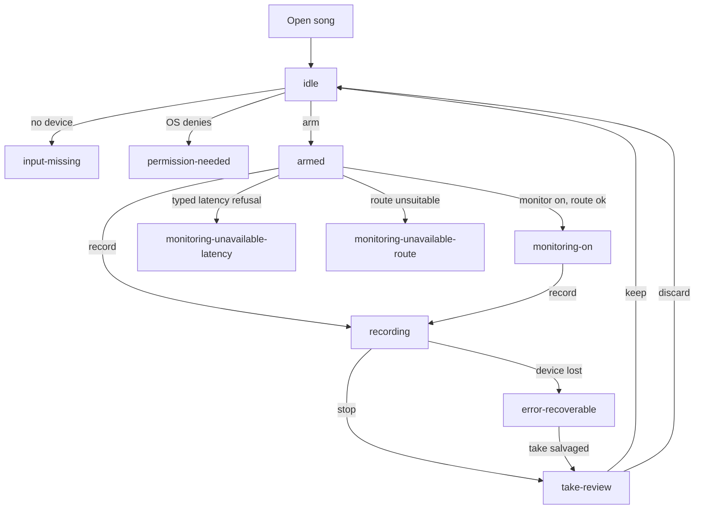

# SingZ Voice strip: journey map and specification

Method: specification-driven development (SDD). Status: common monitoring and
take lane implemented; platform and hardware qualification remain separate.
Authority: [ADR 0016](../../adr/0016-take-as-playback-lane.md) owns take playback;
[ADR 0017](../../adr/0017-monitoring-through-the-common-mixer.md) owns monitoring.
They supersede the corresponding parts of [ADR 0014](../../adr/0014-voice-strip.md). Origin: issue
#136 (input monitoring and recording).

Marking: text tagged **[inferred]** was not read from the ADR, code or docs; it is
this spec's proposal and needs owner review. Everything else restates the ADR or a
file read for this spec (`TrackLane.tsx`, `PitchStrip.tsx`, ADR 0010, `ARCHITECTURE.md`
custom-track section).

## 1 Scope

The Voice strip is one extra row in the song player's mixer, beside the stems. It
lets a singer who sings along to a song (in this product "lessons" means singing
along in the song player, not the Train tab) hear themselves, record a take and
play it back against the song. It is the first step toward the DAW session engine
(the destination); it is not that engine.

Controls on the strip follow the Reaper track model: input selector (device and
mono channel); a Record-arm button (red circle) that arms or disarms recording; a
Speaker button that turns input monitoring on or off (off by default); mute and
solo for take playback; one fader; record; and the take clip. There is no separate
"Mon" chip and no headphones button. The fader edits the monitor level while the
Speaker is on and the take playback level otherwise; its tooltip and label say
which. Whether monitoring is available does not depend on song playback.

### Product rules carried from the ADR (owner decisions 2026-11-12)

| Rule | Statement |
| --- | --- |
| R1 | Monitoring uses capture history and the common output at its existing period. Settings owns per-device buffer preferences. Show the estimated round trip and a delayed marker above 10 ms; never shrink a playing song period for monitoring. |
| R2 | No headphone confirmation. Monitoring is the user's choice. Supersedes the ADR 0010 wired-headphone gate and Settings checkbox. |
| R3 | Recording is allowed at any tempo and transpose. The take is conformed to project time and plays as a transient lane under the current song tempo/key (ADR 0016). |
| R4 | Takes are local only. Mono only in v1. |
| R5 | Monitoring never pauses the song. |
| R6 | ASIO is out of scope. Windows monitoring uses zCore's WASAPI host. |
| R7 | Milestones: M1 record and listen back (no live monitoring); M2 monitoring (macOS, then Windows); M3 takes list, add as track, phones. |

### Relation to existing UI vocabulary

- Stem lanes (`TrackLane.tsx`) already use `chip mute` / `chip solo` with
  `aria-pressed`, a volume range with `title`, inline rename and a remove action,
  and i18n keys under `player.lane.*`. The Voice strip reuses these chips and
  patterns so it reads as one more lane. **[inferred]** New keys live under
  `player.voice.*`.
- `PitchStrip.tsx` already owns a microphone for pitch scoring with states
  `off | starting | on | denied`, a device report callback and a lease-blocked
  message (`pitchMicrophoneUnavailableCopy`). The Voice strip and the pitch strip
  can both want the mic; sharing one capture is an open question (OQ-6).
- ADR 0010 gave Settings a monitoring preview with an app-shell coordinator and a
  top-bar Stop. The Voice strip replaces it (M2 deleted the Settings preview, its
  coordinator, native session and ownership kind; old preference fields are
  ignored on read; `parkOutput` remains for mobile). ADR 0010 is superseded. The
  song player no longer releases output to a silent sink to monitor.
- Monitoring uses shared capture history and one additive common-mixer client.
  Master gain and limiter apply to song, cues and voice (ADR 0017).

## 2 Personas and jobs-to-be-done

Persona content is expected-customer reasoning to validate, not measured research.

### P1 "Can't hear my voice" (issue #136 reporter) **[inferred details]**

Practises songs by singing along on a desktop with wired or USB headphones. After a
lesson they cannot hear their own voice in the headphones and feel they are singing
blind; they sing flat or push too hard. Expects monitoring like a karaoke bar.

- JTBD: "When I sing along to a backing track, I want to hear myself in the mix
  right now, so I can pitch and time what I sing."
- Success: turns on the strip's monitor, hears their voice within the latency
  target, adjusts level, never has the song stop.
- Risks: echo or feedback with speakers; delay that feels like an echo; confusion
  about which input is selected.

### P2 Returning singer comparing progress **[inferred details]**

Sings the same song over weeks. Wants evidence of improvement and a way to hear
last week's take against today's.

- JTBD: "When I come back to a song, I want to hear my earlier attempts against the
  same backing and see how I scored, so I know whether I am improving."
- Success: finds the takes for this song, sees match %, plays one against the song,
  keeps the best, discards the rest. (Takes list and match % are M3.)
- Risks: takes recorded at a different tempo or key than now (the visible effect controls describe the applied shift); losing takes when a project is moved.

### P3 Built-in mic or Bluetooth user **[inferred details]**

Laptop with the built-in microphone, possibly Bluetooth headphones, maybe speakers.
Does not know about latency. Wants to record and listen back with minimal setup.

- JTBD: "When I have no special gear, I want to record myself and hear it against
  the song, even if live monitoring is not possible on my setup."
- Success: records on any route; sees a plain reason when monitoring is unavailable
  (R1: Bluetooth and other high-latency routes); is not blocked from recording.
- Risks: built-in mic over speakers picks up the song (open: warn or refuse,
  owner has not decided, OQ-1); a Bluetooth output adds large unreported latency
  that misplaces the take (see VS-REC-004).

## 3 Customer journey map (desktop first)

Columns: stage, user goal, actions, system response, emotion/pain, opportunity,
milestone. Emotion and pain are expected, to validate. Phones are M3 and noted per
stage; no phone behavior is specified beyond placement.

| # | Stage | User goal | Actions | System response | Emotion / pain | Opportunity | M |
| --- | --- | --- | --- | --- | --- | --- | --- |
| J1 | Discover | Learn that the player can record and monitor | Opens a song, sees a Voice row under the stems | Strip appears in `idle` with mute on, no sound, record button, empty clip area; no modal, no onboarding gate | Curious. Fears accidentally making noise | One row, consistent with stems; nothing starts on its own | M1 |
| J2 | Set up input | Pick the right mic and channel | Opens the input selector; chooses device and channel; grants OS permission if asked | Lists devices with a mono channel choice; remembers the choice; shows `permission-needed` or `input-missing` with a next step; shows a live level meter once armed | Anxious about permission prompts; confused by multi-channel interfaces | Default to the system input; show a meter so success is visible before recording | M1 |
| J3 | Sing with monitor | Hear own voice with the song | Turns the Speaker (monitor) button on; sets the monitor level; sings | Voice joins the output mix within latency; song keeps playing (R5); `monitoring-on`. Larger periods show a delayed badge | Delighted if natural; irritated by echo or delay; blocked if disabled | Latency shown as a reason only when it matters; no headphone nag (R2) | M2 |
| J3a | Monitoring unavailable | Understand why no live monitoring | Sees disabled monitor control | `monitoring-unavailable-latency` or `monitoring-unavailable-route` with the reason; record and playback remain | Disappointed but informed | Suggest a wired or lower-latency route; link to input selector | M2 |
| J4 | Record a take | Capture a performance against the song | Presses record (song playing or starts it); sings; stops | Take placed by capture time minus input, output and graph latency; clip grows on the strip; `recording`; stop yields `take-review` | Focused, slightly exposed. Pain: fear of losing a take on a hiccup | Recording never interrupts the song; crash-safe journal; clear device-loss behaviour | M1 |
| J5 | Replay take | Hear the take against the song | Presses normal transport Play | The active take lane follows the project timeline and current tempo/key; seek and loop work | Self-critical. Pain: take sounds early or late | Verified alignment; take level separate from live level | M1 |
| J6 | Compare over time | Hear earlier attempts and progress | Opens takes list for the song; plays two takes; reads match % | Takes list per song with date, length, match %, recorded tempo and transpose | Motivated by progress. Pain: unclear why a take sounds different | Show recorded settings on each take | M3 |
| J7 | Keep, discard or add | Decide what to do with a take | Keeps, deletes, renames, or "Add to song as track" | Delete removes audio and sidecar after confirm; add as track creates a custom track lane from the take | Relief or regret. Pain: irreversible delete | Confirm delete with the take's name; add-as-track is copy, not move | M3 |
| J8 | Phone | Same flow on iOS and Android | n/a for desktop | Takes list and playback on phones | n/a | Ship takes first, recording on phones later **[inferred]** | M3 |

### Journey flow

## 4 UI state machine

### 4.1 States

States are named exactly as in the prototype. Monitoring-related states are
sub-states of the strip's input being live; they can coexist with `recording` and
normal transport playback as flags, but the strip shows exactly one primary state.
**[inferred]**: primary state precedence is
`error-recoverable` > `recording` > `take-review` >
`permission-needed` > `input-missing` > `monitoring-*` > `armed` > `idle`; the
monitor availability is also a flag shown on the monitor control in every state.

| State | Meaning | Mute chip | Solo | Level | Record button | Take clip |
| --- | --- | --- | --- | --- | --- | --- |
| `idle` | Strip present, no input open, no take pending. Default on open. | muted, enabled | enabled but has no effect until input is live **[inferred]** | enabled, applies to monitor and later takes | enabled; pressing arms then records **[inferred]** | none, or last take of this session |
| `input-missing` | No usable input device, or the chosen device is gone. | disabled | disabled | disabled | disabled | previous take stays playable |
| `permission-needed` | OS has not granted microphone access. | disabled | disabled | disabled | enabled; pressing triggers the OS request, else shows how to enable it | previous take stays playable |
| `armed` | Record-ready: the Arm button is lit, input open, meter live, not recording. Independent of monitoring (VS-MON-025). | muted (monitoring off), enabled | enabled | enabled | enabled | previous take if any |
| `recording` | Capturing a take against the playing song. | take lane only; capture and monitoring are unchanged | enabled | enabled; level does not change captured audio **[inferred]** | shows stop | growing clip with elapsed time |
| `take-review` | Take finished, not playing. | enabled | enabled | enabled | enabled (new take) | take selected; play, keep, discard, rename (M3 add as track) |
| `monitoring-on` | Speaker on, common history client audible; the monitor holds the input open (meter live) without lighting Arm. | unmuted | enabled | the fader edits the monitor level (default -6 dB, remembered) | enabled | as before |
| `monitoring-unavailable-latency` | Native route refused with a typed latency reason. | disabled, reason visible | enabled | enabled for take level | enabled | as before |
| `monitoring-unavailable-route` | Typed reason from the device inventory (direction and transport): Bluetooth, wireless, recognized virtual feedback, permission, missing input or `platform` (non-macOS in v1). | disabled, reason visible | enabled | enabled for take level | enabled | as before |
| `error-recoverable` | Capture, device or storage fault that the user can recover from. | per cause | per cause | per cause | retry or choose another input | salvaged take if any |

### 4.2 Transitions

| From | Trigger | To | Notes |
| --- | --- | --- | --- |
| (open song) | Song project loaded | `idle` | Mute on, nothing captured. |
| `idle` | Input selector choice, or first interaction | `armed` | Opens input; requests permission if needed. |
| `idle`, `armed` | No device at open | `input-missing` | |
| `idle`, `armed` | OS denies or has not granted | `permission-needed` | Recovery: OS prompt, or system-settings guidance. |
| `permission-needed` | Granted | `armed` | |
| `input-missing` | Device appears or user picks another | `armed` | |
| `armed`, `idle` | Mute off, route ok (M2) | `monitoring-on` | Song keeps playing (R5). Opens the input as monitoring's own hold; the Arm button is not touched (VS-MON-025). The song period is unchanged. |
| `recording` | Mute off or on | `recording` | Common monitor client attaches or detaches; the take holds the input, nothing is armed or released (VS-MON-021). |
| `armed` | Speaker on, typed latency refusal | `monitoring-unavailable-latency` | Control disabled. |
| `armed` | Mute off, route class unsupported | `monitoring-unavailable-route` | Control disabled. |
| `monitoring-on` | Mute on | `armed` or `idle` (whichever Arm says) | Gain ramped, no click; the common output remains available (VS-MON-016). |
| `monitoring-on` | Route becomes unsupported or is lost | matching `monitoring-unavailable-*` | Monitoring stops with ramp; song continues. |
| `armed`, `monitoring-on`, `idle` | Record pressed | `recording` | Starts song transport if stopped **[inferred]**; captures from now. |
| `recording` | Stop pressed, or song reaches end | `take-review` | Take finalized and persisted before the state changes. |
| `recording` | Device lost | `error-recoverable` | See 4.4. |
| `take-review` | Keep | `idle` or `armed` | Take remains stored. |
| `take-review` | Discard | previous | Confirm; audio and sidecar removed. |
| `error-recoverable` | Retry succeeds | `armed` | |
| `error-recoverable` | Salvaged take exists | `take-review` | |
| any | Song closed or another song opened | `idle` | Live input released; stored takes remain. |

### 4.3 Seek, loop, tempo and transpose while recording

| Event during `recording` | Behavior |
| --- | --- |
| Seek | Allowed. Take is split at the seek: the current take ends and `take-review` is not shown mid-seek; recording continues as a new take starting at the new position. OQ-2 asks whether to instead block seek or stop recording. |
| Loop wraps | Each loop pass is its own take segment placed at the loop start; the takes list groups them as one session (OQ-2). |
| Tempo change | Allowed. Recorded audio is not stretched. The sidecar records the tempo at start and every change as a timeline of changes for conform to project time. |
| Transpose change | Allowed. Same rule: the sidecar records the transpose and its changes. Raw captured audio is unchanged; playback applies the visible pitch-follow effect. |
| Pause | Recording continues capturing but the take timeline pauses with the song; silence is not padded **[inferred]**. |
| Song end | Recording stops and moves to `take-review`. |
| Window or app loses focus | Recording continues. Monitoring never pauses the song (R5). |
| Mute or solo toggled | Affects the take lane and song mix only, never live monitoring or captured audio. |

### 4.4 Device disappears mid-take

| Moment | Behavior |
| --- | --- |
| During `recording` | Stop capture, keep everything captured so far. Move to `error-recoverable` with the message "input disconnected"; show the salvaged take with its true length. The song keeps playing. Monitoring, if on, goes silent without a click. |
| Recovery | User picks another input or reconnects the device; `armed` resumes. The salvaged take is offered in `take-review`; a new take must be started explicitly. |
| During `monitoring-on` | Monitoring stops; state becomes `input-missing`; song keeps playing. |
| During transport playback | Playback is not affected (it does not use the input). Strip may show `input-missing` as a flag. |
| Output device lost | Existing player behavior applies; recording continues only if capture is intact, but the take's output-latency placement is flagged unreliable in the sidecar **[inferred]**. |

## 5 Requirements

Format: EARS or Given/When/Then. Priority is MUST or SHOULD. Milestone tags are
M1, M2, M3. Every requirement is intended to be testable; the test column in section
5.7 names the test type. IDs are stable; retired IDs are never reused.

### 5.1 Recording (VS-REC)

| ID | Requirement | Pri | M |
| --- | --- | --- | --- |
| VS-REC-001 | WHEN the user presses record in `armed`, `idle`, `monitoring-on` or `take-review`, THE SYSTEM SHALL start capturing mono audio from the selected input and enter `recording` within 250 ms **[inferred threshold]**. | MUST | M1 |
| VS-REC-014 | **New (one-press Record).** The transport Record button (next to Play) SHALL always be available except for a real blocker (no microphone access, no input, an error, no song), and SHALL name the blocker in its tooltip. ONE press SHALL start recording from any state, including idle and not armed: it opens the selected input if needed and starts the take; pressing again stops and keeps the take for review. A take under review SHALL be kept and a take playing back SHALL be stopped by that press. The red-circle arm button is only an arm/disarm toggle (input ready, meter live) and is not needed to record. An explicit Arm SHALL persist through recording and after Stop: the track remains armed, the meter stays live and the next take reuses the open input. A one-press Record from disarmed idle acquires only a take hold and releases it after Stop; Monitor retains its independent hold. | MUST | M2 |
| VS-REC-015 | **New (one time axis).** The Voice lane SHALL be a row of the song stack's own grid, so it uses the stems' exact time axis (zoom, horizontal scroll, duration, left offset, tempo and transpose handling) and the same playhead and seek overlay. A take clip SHALL sit at its capture offset on that axis and be hidden when scrolled out of view. | MUST | M2 |
| VS-REC-017 | **New (lane height, tag, silent take).** The Voice lane row SHALL be as tall as a stem lane (the same 1fr share, never below 104 px) so the clip's waveform reads as a waveform; while recording the clip grows from the playhead and draws the live waveform, with a visible flat centre line when the input is silent. The clip tag SHALL name only what differs from the song, with units (`Tempo 80%`, `Pitch +2 st`, `Changed mid-take`), and SHALL be absent for a take at 100% and 0. A finished take whose peaks are all below -50 dBFS SHALL show `No signal recorded` in the tag area. The lane SHALL NOT draw hint text over its free space (no armed or empty-lane message); armed state shows only through the Arm button, the meter and the strip accent. | MUST | M2 |
| VS-REC-018 | **New (in-app tooltips).** Every control of the strip, the take actions, the clip, the meter, the transport Record button and the Track settings popup SHALL show an in-app tooltip (Tooltip.tsx: after 400 ms of hover or at once on keyboard focus; hidden by leaving, blur, pointer press, Esc or scroll; placed above, or below when there is no room, inside the viewport; `aria-describedby` while shown; a wrapper so a disabled control still shows its reason; no animation under `prefers-reduced-motion`). Native `title` attributes SHALL NOT be relied on; every control keeps its `aria-label`. | MUST | M2 |
| VS-REC-016 | **New (take waveform).** WHILE recording, the clip SHALL draw a growing waveform from the live input level (loudest reading per 50 ms), and the finished take SHALL keep it. A take loaded from disk (recovered, or after a restart) has no peaks until main provides them (needs a take-peaks reply from the voice-takes list; not built). | MUST | M2 |
| VS-REC-002 | THE SYSTEM SHALL record on the capture delivery sink with raw timestamps; the only real-time side effect of recording SHALL be one lock-free journal append (ADR M1). | MUST | M1 |
| VS-REC-003 | THE SYSTEM SHALL place a take at capture time minus input latency, output latency and graph latency. | MUST | M1 |
| VS-REC-004 | GIVEN a loopback test with a known pulse, WHEN a take is recorded and played back, THEN the pulse in the take aligns with the song's pulse within 10 ms **[inferred threshold; set from the spike]** on every supported desktop route. A deliberate offset control SHALL fail this test. | MUST | M1 |
| VS-REC-005 | WHEN latency is unreported, THE SYSTEM SHALL use the existing measured-trim fallback and mark `latencySource: "measured-trim"`. Before opening a take, known unstable input latency or a reported zero output latency SHALL be retried for at most 2 s; a still-covered take may then start with additive v1 `placementEstimated: "latency-not-settled"` (unreported legacy facts use `"latency-unreported"`). The measured capture position SHALL never be normalized to match earlier takes: cold input-open time is part of its true timeline placement. | MUST | M1 |
| VS-REC-006 | WHEN the user changes tempo or transpose during `recording`, THE SYSTEM SHALL continue recording and append the change to the take's settings timeline (section 4.3). | MUST | M1 |
| VS-REC-007 | WHEN the user seeks or the loop wraps during `recording`, THE SYSTEM SHALL follow the rule chosen for OQ-2 and SHALL NOT lose already captured audio. | MUST | M1 |
| VS-REC-008 | WHEN the input device is lost during `recording`, THE SYSTEM SHALL preserve all audio captured so far as a take, enter `error-recoverable` and keep the song playing. | MUST | M1 |
| VS-REC-009 | WHEN the app crashes or quits during `recording`, THE SYSTEM SHALL recover the take from the journal on next launch and offer it in the takes list marked as recovered. A take longer than 30 s SHALL survive restart (ADR work package 1b). | MUST | M1 |
| VS-REC-010 | WHILE recording, THE SYSTEM SHALL NOT pause, stutter or change the song's playback. | MUST | M1 |
| VS-REC-011 | THE SYSTEM SHALL record mono only; a multi-channel device SHALL record exactly the user-chosen channel. | MUST | M1 |
| VS-REC-012 | WHEN the mute chip is toggled during `recording`, THE SYSTEM SHALL NOT change the recorded audio. | MUST | M1 |
| VS-REC-013 | WHEN the take's storage is full or write fails, THE SYSTEM SHALL stop with `error-recoverable`, keep what was written and name the cause. | MUST | M1 |

### 5.2 Monitoring (VS-MON)

| ID | Requirement | Pri | M |
| --- | --- | --- | --- |
| VS-MON-001 | The Voice strip SHALL start with monitoring off (Speaker off) on every app launch (a monitor already running when a song is opened or changed stays on, VS-MON-023); the enable decision SHALL NOT persist across restart (carried from ADR 0010). | MUST | M1 |
| VS-MON-002 | Speaker-on SHALL retain shared capture and add the voice to the common mixer/output, including with no song. Toggle-off drains only the monitor client. Monitoring SHALL NOT arm recording, reopen the song host or pause the song. | MUST | M2 |
| VS-MON-003 | The monitor SHALL use the current capture/output periods and rates to compute its history queue floor and estimated round trip. Settings controls buffer preferences; monitor-on SHALL NOT retune an existing song output. | MUST | M2 |
| VS-MON-004 | A valid history route with a larger buffer SHALL remain monitorable with a visible delayed badge. A typed native latency refusal SHALL leave recording and take playback available. | MUST | M2 |
| VS-MON-005 | Unavailable routes SHALL show a typed reason: Bluetooth, wireless, recognized same-device virtual feedback, missing input, permission, device loss or unsupported platform. Separate wired input/output devices, built-in, virtual and aggregate routes SHALL be allowed under ADR 0017 safety policy. | MUST | M2 |
| VS-MON-006 | THE SYSTEM SHALL NOT require a headphone confirmation or checkbox before monitoring. **Changed:** a quiet first-use hint, "Use headphones to avoid feedback", is allowed and is not a gate. | MUST | M2 |
| VS-MON-007 | Monitoring SHALL NOT pause the song or change its period. Enabling, disabling, level changes and input changes SHALL preserve the common song output. | MUST | M2 |
| VS-MON-008 | Gain changes and mute SHALL be ramped. The common service master SHALL apply gain then a non-defeatable -1 dBFS limiter with zero added latency to every additive client. Monitor gain is -60..+36 dB (`src/shared/voice-monitor-gain.ts`, mirrored in `voice_monitor_client.h`). The monitor has no private ceiling. | MUST | M2 |
| VS-MON-009 | THE SYSTEM SHALL handle the song's tempo and transpose without altering the monitored voice (rate handling per ADR M2). | MUST | M2 |
| VS-MON-010 | **Superseded by VS-MON-016.** (Was: a short dropout may occur whenever the buffer changes.) | SHOULD | M2 |
| VS-MON-011 | The Settings monitoring preview, its coordinator, native session and ownership kind, the top-bar monitor Stop and desktop monitor exclusivity SHALL be removed (`parkOutput` remains for mobile); song play SHALL NOT be refused while monitoring; the old preference fields SHALL be ignored on read. **Done in M2.** | MUST | M2 |
| VS-MON-012 | Windows monitoring qualification remains pending. The portable history path supports independent capture/output clocks and large output periods; a shared period alone is not a refusal. ASIO remains out of scope. | MUST | M2 (Windows) |
| VS-MON-013 | WHILE monitoring with built-in microphone and speakers, THE SYSTEM SHOULD warn about feedback. Behavior is undecided (OQ-1). | SHOULD | M2 |
| VS-MON-014 | **Changed.** The strip SHOULD show the estimated round-trip latency as a badge (see VS-MON-003); it is an estimate until measured with a loopback cable. | SHOULD | M2 |
| VS-MON-015 | **New.** Monitoring SHALL be supported on macOS only in v1; other platforms report `platform` and every other strip function works. | MUST | M2 |
| VS-MON-016 | The service owns output lifetime and buffer leases. A joining song SHALL adopt a running common monitor host capacity/period; stopping a graph SHALL preserve live monitoring. Period-only reopens SHALL preserve capture and re-admit the common client. | MUST | M2 |
| VS-MON-017 | **New (channel picker).** The strip SHALL list every input channel of each device and record or monitor exactly the chosen one. | MUST | M2 |
| VS-MON-018 | **New (gain preset).** Monitor gain SHALL default to -6 dB (was -12, too quiet) and be remembered. The fader SHALL edit the monitor level exactly while the Speaker button is on and the take playback level otherwise; its tooltip and aria-label SHALL name which. There SHALL be no "Mon" chip and no other control that shows monitoring; the Speaker button SHALL be lit when on and dimmed, with the reason as its tooltip, when unavailable. | MUST | M2 |
| VS-MON-019 | **Superseded by VS-MON-025.** (Was: turning monitoring on arms the input.) | MUST | M2 |
| VS-MON-023 | **New (independent of the song).** A running monitor SHALL keep running across song loading, song change, song unload, the library or catalog view (the Voice host unmounting) and playback end; the controller is one per engine and a host unmount only resets arm and take state. After a route change or playback stop the strip SHALL publish the common output context and refresh availability after it settles; only transient `error` uses bounded retry. It SHALL stop only on Speaker off, device or route loss, input change, or app quit (the controller being torn down). Song change still resets arm and take state. | MUST | M2 |
| VS-MON-024 | Track settings SHALL have no monitor output picker. The monitor always follows Settings > Audio route. The IPC contains only the common output display name (`commonOutputName`), never an independent monitor selector or candidate list. A stored `singz.voice.monitorOutput` is ignored and removed once. Take capture is never restarted by monitor controls. | MUST | M2 |
| VS-MON-020 | **New.** The monitoring decision SHALL never be persisted as on (restates VS-MON-001 for M2). | MUST | M2 |
| VS-MON-022 | **New (availability).** Monitor availability SHALL NOT depend on song playback: the strip SHALL NOT show or retry `output-not-native` as a play-state problem and SHALL NOT re-ask availability on play or pause. It SHALL re-ask on route, output or input change, with a bounded retry (+0.5, +1.5, +3 s) only for a transient `error`. | MUST | M2 |
| VS-MON-025 | **New (Arm and Monitor are independent, DAW model).** Arm means record-ready (red Arm button; input kept open, meter live); Monitor means hear myself (Speaker button). They are two independent states: (a) Arm without Monitor opens the input and leaves monitoring off; (b) Monitor without Arm opens whatever input it needs and never lights or changes Arm; (c) disarming while monitoring keeps monitoring running; (d) turning Monitor off while armed keeps the Arm state and the input open; (e) Record works from any state in one press (VS-REC-014) and leaves both states as they were; an explicit Arm is never consumed by a take. Only an implicit Record hold is released at take end, and renderer reload releases only that renderer's holds. **Input ownership:** the input is open in main while ANY of arm, monitor (on or opening) or a take (starting or recording) holds it; each reason releases only its own hold and the last one out closes the input (`inputHeld`/`releaseInputIfUnused` in voice-take.ts). The meter is live whenever armed, monitoring or recording. Changing the input or channel stops monitoring and re-arms an explicit arm on the new option. **No song:** monitoring and its availability do not need a song (the monitor IPC carries no song id); Record, Arm for a take and take actions still do. A song change resets Arm and take state, never a running monitor. Main tracks whether a meter arm belongs solely to monitoring; turning monitor off preserves an independently armed strip, including an explicit Arm promoted from a monitor-only open. | MUST | M2 |
| VS-MON-027 | THE SYSTEM SHALL refuse a recognized same-UID virtual loopback route (BlackHole/Soundflower families) with `route-feedback`. Aggregate input/output pairs remain allowed with the existing virtual/unclassified latency warning. Same-UID virtual routes not recognized as loopback (including remote adapters such as NoMachine) SHALL be allowed with a localized feedback warning and a starting monitor gain of -40 dB or lower; entering that route during output migration applies the same policy before callbacks resume. Later deliberate fader adjustment is allowed; a period-only reopen in the same session preserves it. Labels are hints, not authoritative topology; the inventory exposes no manufacturer, driver identity or aggregate membership. | MUST | M2 |
| VS-MON-026 | THE SYSTEM SHALL default the monitor level to -6 dB on first use and remember the user's choice; stored values within -60..+36 are valid. The Monitor level control SHALL map fader to dB piecewise (finer steps in -24..+24, 0 dB at mid-travel and marked in Track settings), and SHALL show "High gain: feedback risk" above +12 dB. | MUST | M2 |
| VS-MON-021 | **New (mid-take rules).** Toggling monitoring during a take SHALL NOT arm the input (the take holds it); turning monitor off mid-take SHALL release only the monitor; the take SHALL complete with its true duration. Starting and stopping a take preserve any pre-existing meter Arm purpose (explicit or monitor-only), including the visible Arm state, live meter and capture lease; the native Take user independently owns capture and does not convert a monitor-only Arm into record readiness after recording. | MUST | M2 |
| VS-MON-022 | **New (capture-gap contract, input).** WHEN the device buffer grows and one render fails with -10874 (`kAudioUnitErr_TooManyFramesToProcess`), THE capture SHALL replace that block with silence of the same length using the callback's own timestamps and count it (`renderSliceDrops`); IF it persists for more than 64 consecutive callbacks or ~250 ms, THEN it SHALL fail. | MUST | M2 |
| VS-MON-023 | **New (padding contract, take writer).** THE take writer SHALL pad forward host-time gaps with silence on the writer thread, only for Hardware-quality timestamps (macOS), comparing each block with the previous one (never a cumulative baseline, which drifts with the sample clock). Caps: 2 s per gap, 10 s per take, then `gapOverflow` and status `partial-error`. Stats SHALL include `gapPaddedFrames`, `gapPaddedBlocks`, `gapUntrustedTimestampBlocks`, `gapRegressions`, `gapOverflow`. A healthy take SHALL pad 0 frames. | MUST | M2 |

### 5.3 Take playback (VS-PLAY)

| ID | Requirement | Pri | M |
| --- | --- | --- | --- |
| VS-PLAY-001 | Normal transport Play SHALL play the active conformed take as the transient `voice:take` lane, aligned to project time and sharing the stems’ seek, loop, count-in, pause and seam behavior. | MUST | M1 |
| VS-PLAY-002 | The take SHALL follow current song tempo and key through the ordinary song bus. Offline conform normalizes the recorded timeline and applies the take’s ordered effects. | MUST | M1 |
| VS-PLAY-003 | The strip SHALL show recorded settings, the visible Pitch follow effect and a voice-shifted tag beyond three semitones. It SHALL NOT change the song settings to replay a take. | MUST | M1 |
| VS-PLAY-004 | The take SHALL have its own level, independent of live monitoring level **[inferred]**. | SHOULD | M1 |
| VS-PLAY-005 | WHEN the user seeks in the song while a take plays, THE SYSTEM SHALL keep the take aligned to the song's timeline. | MUST | M1 |
| VS-PLAY-006 | Voice Mute/Solo SHALL affect the recorded take in the stems’ solo group. The live monitor SHALL obey only Speaker and common master; it is unaffected by lane Mute/Solo or the recording silence rule. | MUST | M1 |
| VS-PLAY-007 | WHEN playing a take, THE SYSTEM SHALL work without any input device present. | MUST | M1 |
| VS-PLAY-008 | The takes list SHALL show per song: date, length, match %, recorded tempo and transpose, and SHALL allow play, rename, delete. | MUST | M3 |
| VS-PLAY-009 | "Add to song as track" SHALL create a custom track from a copy of the take and leave the take in place; deleting the track SHALL NOT delete the take. | MUST | M3 |
| VS-PLAY-010 | On phones the takes list and take playback SHALL be available; recording on phones is not committed. **[inferred]** | SHOULD | M3 |

### 5.3a Take clip: waveform, selection, move and delete (VS-TAKE)

| ID | Requirement | Pri | M |
| --- | --- | --- | --- |
| VS-TAKE-001 | Every button of the strip, its take actions and the track settings popup SHALL have a non-empty accessible name and the same `title` tooltip as the player's other buttons, with the shortcut where one exists (Record (R), Delete take). | MUST | M2 |
| VS-TAKE-002 | The take clip SHALL draw a real waveform (loudest sample per slice, mirrored), never a vertical grid: live from the input level while recording, then from peaks main computes from the take WAV (pcm16 mono, about one per 10 ms, at most 20000, cached by file identity) for both a just-finished take and one loaded from disk. A silent take SHALL draw a flat centre line. The clip rescales with zoom. | MUST | M2 |
| VS-TAKE-003 | The clip SHALL be selectable (click, or Tab then Enter/Space; `role=option`, `aria-selected`, visible selected state and focus ring). Click on an empty lane or Esc deselects. Selection is controller state per song and survives zoom and scroll. Only the clip captures the click: the stems' seek-on-click is unchanged. A take that is still recording SHALL NOT be selectable. | MUST | M2 |
| VS-TAKE-004 | Delete or Backspace on the selected clip, and the Delete button (shown only while a take is selected), SHALL delete that take only (files removed, selection cleared, the newest remaining take becomes audible). | MUST | M2 |
| VS-TAKE-005 | Dragging the clip, or the arrow keys (0.1 s, Shift 1 s), SHALL move it on the song timeline, clamped to [0, song duration - take span], with a live ghost and position readout; Esc cancels a drag. The new start SHALL be stored as `userOffsetSec` in the sidecar (additive, version unchanged) beside the measured `startPositionSec`, which is never overwritten; "Reset position" stores 0. Take playback SHALL start from `startPositionSec + userOffsetSec`, through the conformed project-time lane (ADR 0016). Main validates the request (finite, within 36000 s, never before the song start). | MUST | M2 |

### ADR 0016 engine lane

These rules supersede the playback and monitor/M/S wording above for engines
which expose `setVoiceTakeLane`. The former standalone replay implementation
and its IPC, preload and native exports have been removed.

| ID | Requirement |
| --- | --- |
| VS-LANE-001 | A kept or just-finalized active take plays with normal transport Play as one transient `voice:take` lane. Its conformed WAV includes `startPositionSec + userOffsetSec` as leading silence (negative head trimmed), ends no later than the song, and enters the common song bus before tempo/transpose. Seek, loop, pause/resume and count-in use the same native session as stems. |
| VS-LANE-002 | Mute, Solo and take level use native lane controls and the stems' solo group, without preparing another graph. An empty, unavailable or preparing lane cannot acquire Solo. The live monitor obeys only Speaker, independently of Mute, any Solo and recording. |
| VS-LANE-003 | Starting, recording and finalizing force the old take silent and withdraw its Solo via callback controls. A take source is never replaced during those states. A finalized new take conforms, then replaces the old lane with one prepare while stopped or the existing running-stream seam. |
| VS-LANE-004 | Dragging changes only the UI ghost; a committed drop, keyboard move, reset or FX change debounces conform for 150 ms. Newer requests cancel older work; stale results cannot replace the current lane. Delete removes the lane before releasing its lease and deleting the raw take. |
| VS-LANE-005 | The controller exposes `lane.status`: `idle`, `conforming`, `ready`, `omitted` (reason `lane-limit`, `node-limit`, `graph-incompatible`, `native-unavailable`) or `error` (reason `conform-failed`, `timeout`, `cancelled`, `prepare-failed`). Retry uses `retryTakeLane()`. A take failure never prevents the song from playing. |
| VS-LANE-006 | The optional voice uses one of 16 lanes and three of 128 graph nodes. If it does not fit, omit it and keep the song unchanged. The canonical graph document, saved tracks and project export never include it. |
| VS-LANE-007 | While recording, the existing take lane SHALL be forced silent through lane controls and restored on stop. No take-lane rebuild occurs during recording; the finalized new take is conformed and installed afterwards. |
| VS-LANE-008 | Each returned cache file is leased before an asynchronous prepare can open it. A replacement releases the old lease only after native accepts the new lane. Pinned files and Windows busy files count against the cache bound; old files are reclaimed when no longer in use, without overwriting a file a lane reads. |
| VS-LANE-009 | The ordered `effects` slots (including `pitch-follow`) persist per take. Disabling offline pitch-follow bypasses recorded-key compensation; the common song bus still applies the current song key to every lane. It does not preserve sung pitch against arbitrary song transposition. |

The hardware driver `tests/e2e/mac/voice-take-lane-e2e.cjs` uses an isolated,
generated anchored tone take, checks exact placed PCM (5 ms), native lane source
clock alignment (5 ms), isolated native output peak, Mute/Solo, 0.5× tempo,
+3 st, seek, loop and count-in. Native status has no per-lane live peak or
sample-level post-bus tap: source-clock/PCM checks do not replace physical
loopback and stretched-voice listening acceptance.

### 5.4 Storage and privacy (VS-STORE)

| ID | Requirement | Pri | M |
| --- | --- | --- | --- |
| VS-STORE-001 | Takes SHALL be stored only on the local machine. THE SYSTEM SHALL NOT upload, sync, share or back them up to Drive or any server (R4). | MUST | M1 |
| VS-STORE-002 | Each take SHALL have an audio file and a sidecar with the fields in section 6.1, written atomically (temp then rename) after the audio is complete. | MUST | M1 |
| VS-STORE-003 | WHEN a take is deleted, THE SYSTEM SHALL remove its audio, sidecar and any journal remains. | MUST | M1 |
| VS-STORE-004 | A take SHALL survive app restart. A take longer than 30 s SHALL survive restart without loss (ADR 1b). | MUST | M1 |
| VS-STORE-005 | Takes SHALL be stored outside the project's `stems/` folder and SHALL NOT be included in project save, split, export, share or sync unless the user explicitly adds a take as a track (M3). **[inferred; to avoid leaking recordings via Drive project sync]** | MUST | M1 |
| VS-STORE-006 | IF the song's project is removed or moved, THEN THE SYSTEM SHALL keep its takes keyed by a stable song id, and show them as orphaned with a delete action. **[inferred]** | SHOULD | M3 |
| VS-STORE-007 | THE SYSTEM SHALL tolerate an unknown sidecar `version` by showing the take as unplayable with an explanation and not deleting it. | MUST | M1 |
| VS-STORE-008 | THE SYSTEM SHALL NOT include take audio or sidecars in diagnostics, logs or crash reports. | MUST | M1 |
| VS-STORE-009 | Disk use for takes SHOULD be shown to the user, and a total cap or warning is OQ-7. | SHOULD | M3 |

### 5.5 Internationalization (VS-I18N)

| ID | Requirement | Pri | M |
| --- | --- | --- | --- |
| VS-I18N-001 | Every user-visible string SHALL be `t('player.voice.*')` over `src/shared/i18n/en/*.ts` with RU and zh-CN equivalents (project rule; phones use `phone.*` over `mobile/src/i18n`). | MUST | M1 |
| VS-I18N-002 | One name per concept in all three languages for: the strip ("Voice"), monitoring, take, input. A retired name SHALL NOT remain anywhere in the UI. Final names are an open item (OQ-8). | MUST | M1 |
| VS-I18N-003 | Counts (takes, seconds) SHALL use the locale's plural forms (Russian has three). | MUST | M3 |
| VS-I18N-004 | Layout SHALL keep every control reachable with the longest translation and CJK/Cyrillic fallbacks. | MUST | M1 |
| VS-I18N-005 | Failure reasons (section 7) SHALL be plain language and name the next action; no raw error codes on the strip. | MUST | M1 |

### 5.6 Accessibility (VS-A11Y)

| ID | Requirement | Pri | M |
| --- | --- | --- | --- |
| VS-A11Y-001 | Mute, solo and record SHALL be buttons with `aria-pressed` where toggles, and an accessible name that includes the strip name. | MUST | M1 |
| VS-A11Y-002 | A disabled monitor control SHALL expose its reason to assistive technology (not only a tooltip) and keep it in the tab order or be described by adjacent text. | MUST | M2 |
| VS-A11Y-003 | State changes (`recording`, `error-recoverable`, monitoring unavailable) SHALL be announced via a polite live region; `recording` start and stop SHALL NOT rely on colour alone. | MUST | M1 |
| VS-A11Y-004 | Level SHALL be a labelled slider operable by keyboard, with its value exposed. | MUST | M1 |
| VS-A11Y-005 | The input selector, record and take actions SHALL be operable by keyboard alone; focus SHALL not be lost when state changes. | MUST | M1 |
| VS-A11Y-006 | Meters and the growing clip SHALL respect reduced motion and SHALL have a text equivalent (elapsed time). | SHOULD | M1 |
| VS-A11Y-007 | A global shortcut for record SHOULD NOT conflict with existing player shortcuts (resolve OQ-9). | SHOULD | M1 |

### 5.7 Traceability

Test types: U = unit, C = native C++ / ctest, I = integration (Electron app, fake
audio host), E = end-to-end on hardware or field laptop, M = manual listening,
D = design review. Journey stages from section 3.

| Requirement | Journey stage | Test type | M |
| --- | --- | --- | --- |
| VS-REC-001, 010, 012, 014 | J4 | I, C | M1 |
| VS-REC-015, 016 | J4 | I (live app), U | M2 |
| VS-REC-002, 003, 004, 005 | J4, J5 | C (offset control), E (loopback) | M1 |
| VS-REC-006, 007 | J4 | U (settings timeline), I | M1 |
| VS-REC-008, 013 | J4 | I (fault injection) | M1 |
| VS-REC-009, VS-STORE-004 | J4 | I (kill and restart, take over 30 s) | M1 |
| VS-REC-011 | J2, J4 | C, I | M1 |
| VS-MON-001 | J1 | U, I | M1 |
| VS-MON-002, 003, 009 | J3 | E (spike table), M | M2 |
| VS-MON-004, 005, 012 | J3a | I (typed route fixtures), E | M2 |
| VS-MON-006, 007, 011 | J3 | I | M2 |
| VS-MON-008 | J3 | C (numerical), M | M2 |
| VS-MON-010 (superseded), 013, 014 | J3, J3a | I, D | M2 |
| VS-MON-015 to 021, 025 | J3, J3a | U, I, E (Zen runs), M (docs/specs/voice-strip/manual-test.md) | M2 |
| VS-MON-022, 023 | J3, J4 | C (fault injection, drift), E (310 s take) | M2 |
| VS-PLAY-001, 002, 005 | J5 | C, I | M1 |
| VS-PLAY-003, 004, 006, 007 | J5 | U, I | M1 |
| VS-PLAY-008, 009 | J6, J7 | I | M3 |
| VS-PLAY-010 | J8 | I (phones) | M3 |
| VS-STORE-001, 005, 008 | J4, J7 | I (network and sync inspection), U | M1 |
| VS-STORE-002, 003, 007 | J4, J7 | U | M1 |
| VS-STORE-006, 009 | J6, J7 | I | M3 |
| VS-I18N-001 to 005 | all | U (key parity test), D | M1 / M3 |
| VS-A11Y-001 to 007 | J2 to J5 | U (a11y assertions), I, M (screen reader) | M1 / M2 |

### 5.8 Acceptance scenarios (Given / When / Then)

| ID | Scenario | Covers |
| --- | --- | --- |
| AC-1 | GIVEN a song is open and the strip is `idle`, WHEN the app has just launched, THEN the strip is muted, no capture is open, and no sound is produced from the input. | VS-MON-001 |
| AC-2 | GIVEN `armed` and a song playing, WHEN the user presses record, sings for 40 s and stops, THEN a take exists, the song never paused, the take plays back aligned (loopback pulse within threshold), and after restarting the app the take is still present. | VS-REC-001/003/004/009/010, VS-STORE-004 |
| AC-3 | GIVEN a take recorded at 0.85x tempo and +2 semitones, WHEN the song plays at 1.0x and another key, THEN the conformed take follows project time and the visible pitch-follow settings. | VS-PLAY-002/003, VS-REC-006 |
| AC-4 | GIVEN `recording`, WHEN the USB input is unplugged, THEN the song keeps playing, captured audio is kept as a take with its true length, and the strip shows `error-recoverable` with a reconnect action. | VS-REC-008, 4.4 |
| AC-5 | GIVEN Bluetooth or wireless output, WHEN the user opens the strip, THEN monitoring is disabled with a visible reason while recording and take playback work. | VS-MON-004 |
| AC-6 | GIVEN a supported macOS route, WHEN Speaker is enabled while the song plays, THEN the voice joins the common output, the current song period is unchanged, the delay badge is honest and no confirmation dialog appears. | VS-MON-002/006/007 |
| AC-7 | GIVEN microphone permission is denied, WHEN the user presses record, THEN the strip shows `permission-needed` with the next step; the song is unaffected; granting access returns to `armed` without reopening the song. | J2 |
| AC-8 | GIVEN a deletion of a take, WHEN confirmed, THEN its audio, sidecar and journal files are gone and nothing remained in the project folder or Drive sync. | VS-STORE-003/005 |

## 6 Take data model, storage and privacy

### 6.1 Sidecar fields

One JSON sidecar per take, beside the take audio. Field names are **[inferred]**;
the ADR fixes only the content: song, start position, latencies, transpose, tempo,
match %.

| Field | Type | Meaning |
| --- | --- | --- |
| `version` | int | Sidecar schema version; unknown versions are preserved, not deleted. |
| `takeId` | string | Stable id (uuid). |
| `songId` | string | Stable project id, not a path. |
| `songTitle`, `songArtist` | string | Snapshot for orphaned display. |
| `createdAt` | ISO 8601 | Wall-clock start. |
| `startPositionSec` | number | Song timeline position the take starts at, after latency placement. |
| `durationSec` | number | Length of captured audio. |
| `sampleRate`, `channels` | int | `channels` is always 1 in v1. |
| `inputLatencyFrames`, `outputLatencyFrames`, `graphLatencyFrames` | int | Latencies used for placement. |
| `latencySource` | enum | `reported` or `measured-trim` (VS-REC-005). |
| `input` | object | Device display name and channel index at record time (not a stable device id exposed to users). |
| `settings` | array | Timeline of `{atSec, tempo, transposeSemitones}`; first entry is the state at start (VS-REC-006). |
| `matchPercent` | number or null | Pitch match score for the take; null if not computed (M3). |
| `monitoring` | bool | Whether live monitoring was on while recording. Diagnostic only. |
| `status` | enum | `complete`, `recovered`, `partial-device-lost`, `partial-error`. |
| `name` | string or null | User rename. |
| `audio` | object | File name, format (lossless; FLAC per ADR "reuse format"), byte size, checksum. |

### 6.2 Storage rules

- Location: a per-user app data directory outside the project folder
  (VS-STORE-005), keyed by `songId`. **[inferred]** The exact path is an
  implementation decision; the DAW session engine may later own the layout.
- Write order: journal while recording; encode audio; write sidecar via temp and
  rename; remove journal. Recovery treats a journal without a sidecar as a
  `recovered` take.
- No take is read from or written to a cloud-synced folder by SingZ.
- Format: lossless, mono. The ADR says to reuse the DAW take format with a small
  re-implemented writer; the final container is not fixed here.

### 6.3 Privacy

- Takes are the user's voice. They stay on the machine (VS-STORE-001). No upload,
  analytics, telemetry or crash report may contain take audio, sidecars or
  device names beyond what existing diagnostics already allow (VS-STORE-008).
- Deleting a take deletes everything about it (VS-STORE-003). **[inferred]** A
  "delete all takes for this song" action and an app-wide equivalent in Settings
  belong in M3.
- Microphone access uses the OS permission; the app shows when the input is open
  (meter live) and releases it when the strip is `idle`, the song closes, or the
  app quits. **[inferred]**
- Add-as-track (M3) is the only path that moves voice into a project; it copies,
  and the project's normal save and sync rules then apply. The user must be told
  that the track will be part of the project **[inferred]**.

## 7 Failure modes and copy intent

User-facing strings are EN, RU and zh-CN later. This table specifies intent only:
what the user learns and what they can do. Final copy is not specified.

| Failure | State | Copy intent | Action offered |
| --- | --- | --- | --- |
| No input device | `input-missing` | No microphone found. Connect one or choose another input. | Open input selector |
| OS permission not granted | `permission-needed` | SingZ needs microphone access to record. | Ask again, or how to enable in system settings |
| Chosen device removed | `input-missing` / `error-recoverable` | The input was disconnected. | Reconnect or choose another |
| Device lost mid-take | `error-recoverable` | Input disconnected; the take was saved up to this point. | Keep partial take, choose input |
| Native latency refusal | `monitoring-unavailable-latency` | Hearing yourself live is off: this route delays sound too much. Recording and playback still work. | Suggest a wired or lower-latency output; open input selector |
| Route cannot monitor | `monitoring-unavailable-route` | Live monitoring is not available on this connection. Recording and playback still work. | Suggest another route |
| Feedback risk (built-in mic and speakers) | `monitoring-on` | Optional hint to use headphones; not a gate (R2, OQ-1). | Dismiss |
| Disk full or write error | `error-recoverable` | Could not save the take; what was recorded is kept. | Free space and retry |
| Take file missing or unreadable | `take-review` | This take cannot be played. | Delete, or locate **[inferred]** |
| Unknown sidecar version | list | This take was made by a newer version. | Keep, delete |
| Buffer-size change on first monitor-on | `armed` | No error. One tiny click can occur at the first monitor-on of a song session. | none |
| Engine or audio service error | `error-recoverable` | Audio engine problem; song and take are safe. | Retry |

Rules: reasons name the cause in user terms, never a code; recoverable errors never
block playback of the song; a disabled control always says why.

## 8 Non-goals

- Multi-track editing, punch-in, comping, overdub stacking, take editing (trim,
  fades, effects), recorded-take pitch correction. These belong to the DAW session
  engine, not v1.
- Cloud sync, sharing, export or upload of takes (R4).
- Stereo, multi-channel or multi-mic recording; mono only in v1.
- ASIO (R6); exclusive-mode monitoring.
- Headphone detection or confirmation (R2).
- Merging the DAW branch; only the reviewed lifts listed in the ADR.
- Recording on phones (M3 covers list and playback only **[inferred]**).
- The Train tab; "lessons" here means singing along in the song player.
- Changing LoopZ's Box router.

## 9 Open questions

Also open from M2: per-device persistent monitoring buffer versus the automatic
session hold, whether ~2.8 ms residual per toggle is acceptable, and Windows ASIO
(see section 10 and ADR 0014).

Carried from the ADR (OQ-1, OQ-4 part, OQ-5), and new ones found while writing
this spec (OQ-2, OQ-3, OQ-6 to OQ-10).

| ID | Question | Source | Blocks |
| --- | --- | --- | --- |
| OQ-1 | Built-in mic with speakers: warn, refuse, or nothing? | ADR | VS-MON-013 |
| OQ-2 | Behavior on seek and loop wrap during `recording`: split into takes, stop, or block seek? Proposed here: split / grouped session. | new | VS-REC-007 |
| OQ-4 | Can the spike distinguish `monitoring-unavailable-latency` from `-route`, or do they merge? Also: macOS capture reports no input latency (zCore fact or measured trim); Windows 32 frames depends on the driver's legal minimum; buffer size change is a route change with a short dropout. | ADR + new | VS-MON, VS-REC-005 |
| OQ-6 | The pitch strip also uses the microphone for scoring. Share one capture with the Voice strip (and avoid double permission and double device open), or arbitrate? Does match % come from the pitch strip's analysis? | new | VS-PLAY-008, M3 |
| OQ-7 | Take storage cap, retention and low-disk behavior. | new | VS-STORE-009 |
| OQ-8 | Final user-facing names in EN, RU, zh-CN for Voice, take, monitor. | new | VS-I18N-002 |
| OQ-9 | Record shortcut and conflicts with existing player shortcuts. | new | VS-A11Y-007 |
| OQ-10 | A pause-while-recording take timeline: pad silence or pause the take? Proposed: pause the take. | new | 4.3 |
| OQ-11 | Where do takes live relative to the future DAW session layout, and is the sidecar a subset of the DAW take record? | new | 6.2 |

## 10 Implementation status

The desktop take plays only as an ordinary `voice:take` lane. The native
training mixer now serves cues only. macOS monitoring uses shared capture
history and the common mixer/output; the second monitor host and its song
retune are removed. All common monitor source, client, clock, waveform,
master and diagnostics regressions remain in the native gates.

Portable tests are not hardware qualification: real microphone/loopback,
stretched-voice listening, cross-device clock continuity and Windows field
qualification remain the ADR verification work packages. Phone and Box builds
need their platform checks; this removal does not claim those results.
Manual checklist: [manual-test.md](manual-test.md).

### VS-TAKE: playback lane and effects

Source: ADR 0016 (WP4). A kept take is a playback lane; the strip shows what that lane is doing.

- **VS-TAKE-1 Pitch follow is visible.** With a take present (not while recording) the lane header shows a chip "Pitch follow +3 st": the applied shift (song key minus the take's recorded transposition, plus the manual offset), always shown, dimmed at 0 and when bypassed ("Pitch follow off"). Click toggles bypass through `setTakeEffects`; the tooltip says "The voice follows the song key. Click to bypass." (or how to turn it back on).
- **VS-TAKE-2 Effects list.** Track settings has an Effects section: an ordered list of effect slots (generic `OrderedEffects`; today only Pitch follow: enabled switch, manual offset -12..+12 st, Preserve formants). Help text: bypass disables the offline shift only; the song key shift still applies to every lane. Controls are disabled while recording or starting, and offset/formants while the effect is bypassed.
- **VS-TAKE-3 Voice shifted.** The clip tag adds "Voice shifted" when the applied shift is beyond 3 semitones.
- **VS-TAKE-4 Lane state, never blank.** conforming: subtle spinner on the clip and "Preparing take for playback"; ready: "Plays with the song"; omitted (lane/node limit) "Too many tracks for take playback", otherwise "Take playback is unavailable"; error by typed reason: take-too-long, memory-budget, graph-budget ("Too many tracks"), conform-error, cancelled, each with its own copy and the detail as tooltip. Retry (calls `retryTakeLane`, focus moves to the status text) appears for error states only.
- **VS-TAKE-5 M / S / fader.** M and S are the take lane's native mute and solo ("Mute the take", "Solo the take (monitor is not affected)"); they are aria-disabled with the tooltip "No playable take" until the lane is ready. The fader edits the take playback level while the monitor is off (label "Take playback level") and the monitor level while it is on.
- **VS-TAKE-6 Transport playback only.** The standalone replay buttons and path are removed: the common transport Play/Stop plays the take lane (ADR 0016).
- **VS-TAKE-7 Takes stack, none replaces another.** Every recording is kept. The lane shows one row per take of the song, newest on top (the Reaper/DAW convention: later recordings stack above earlier ones; row order never follows the selection). A new recording becomes the selected, audible take. Clicking (or Enter/Space on) a take block selects it and makes it the audible one: it is conformed and streamed as the `voice:take` lane through the existing conform/ready flow; Solo, Mute and the fader keep acting on the lane. Unselected takes are drawn dimmed. Move and Delete act on the selected take. A Delete button appears in the lane header only while a take is selected; deleting removes that take only and the newest remaining take becomes the audible one. The lane carries no status prose: Keep, Add-to-song and "Plays with the song" are gone; recording/review/monitoring notes, tempo/pitch tags and "Voice shifted" moved into tooltips. Errors that need action (device lost, permission, retry, feedback risk) and the Pitch follow chip stay. The earlier "newest stored take replaces the others" behaviour was a renderer limit (one `take` in the model, only the newest listed at song load), not storage: main always kept every sidecar.

Clickable prototype: [prototype/](prototype/) (states: pitch-shifted, lane-conforming, lane-take-too-long, lane-memory-budget, lane-graph-budget, lane-conform-error, lane-cancelled).

### VS-MON delayed route

When the monitor state reports `latency.delayed` (estimated round trip above the 10 ms same-device budget, e.g. a cross-device route or a larger buffer) the strip badge reads just "52 ms" (no approximation sign, no "delayed" word) in an amber outline, its tooltip says "Your input and output are on different devices or use a larger buffer: expect a noticeable delay", and the Track settings route line ends with "delayed". The route line names the input device when it differs from the output ("MacBook Pro Microphone → Zen Quadro SC Playback"), from the additive `VoiceMonitorState.inputDevice` set by the main monitor. Not delayed: no marker.
